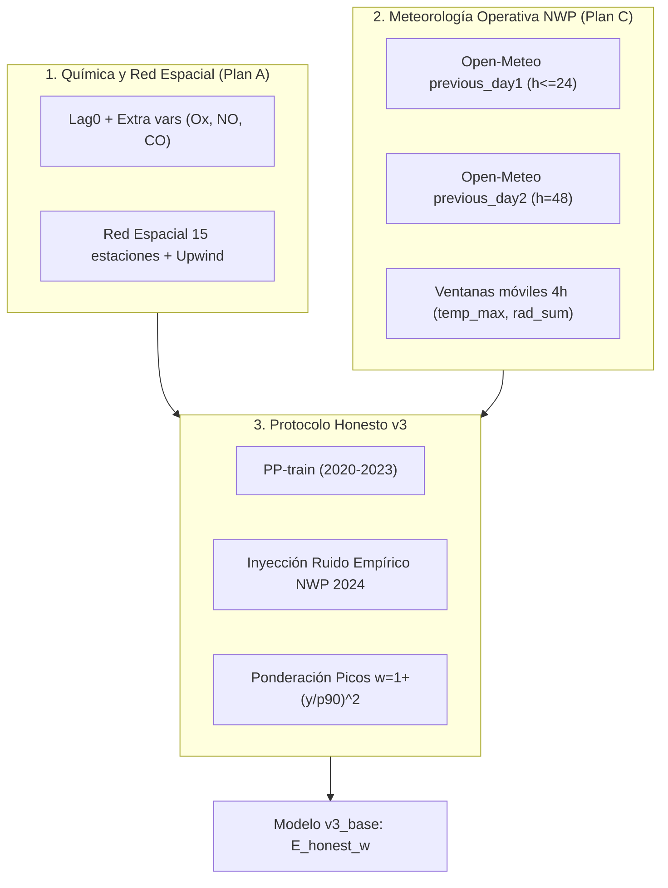

# Reporte Experimento: Modelo Base v3 (Plan A Química + Plan C Meteorología Honesta)

**Carpeta del experimento**: `experiments/noche/v3_base/`  
**Fecha de ejecución**: 30 de Octubre de 2026  
**Responsable**: Científico de Datos — Antigravity Multi-Agent Squad  
**Contrato**: `experiments/noche/README_noche.md` y `experiments/README_experimentos.md`  
**Recursos**: LightGBM `num_threads=4`, CPU only (sin GPU), split temporal estricto (Train: 2020–2023, Val: 2024, Test: 2025).

---

## 1. Resumen Ejecutivo

El objetivo primordial de este experimento fue construir el **modelo base "v3"** para el pronóstico de ozono troposférico ($O_3$) en las 13 estaciones operativas del SIMA Monterrey para todos los horizontes requeridos:
$$h \in \{1, 4, 8, 12, 24, 48\} \text{ horas}$$

Este modelo integra de forma armónica y rigurosa los dos avances principales del proyecto:
1. **Plan A (Química Avanzada y Red Espacial)**: features contemporáneas de emisión ($t=0$, lag 0), contaminantes antes no considerados ($NO, NO_2, O_x = O_3 + NO_2, CO, SO_2$), meteorología local SIMA en $t \le 0$ ($SR, TOUT, RH, PRS, RAINF, U/V\_Wind$) y descriptores espaciales leave-one-out de la red de 15 estaciones con advección upwind.
2. **Plan C (Pronósticos Meteorológicos Externos Open-Meteo)**: covariables meteorológicas futuras bajo un estricto **protocolo honesto operativo (PP-train / NWP-test)**, eliminando la fuga de información identificada en iteraciones previas donde se usaban corridas seamless como pronósticos en $h \le 12$.

### Hitos y Resultados Principales en Test 2025:
- **Salto cualitativo frente a v2 (Script 7)**:
  - En $h=1$, el RMSE cae de **8.05 ppb** a **5.04 ppb** ($R^2$ sube de 0.854 a **0.943**), con skill del **66.1%**.
  - En $h=4$, el RMSE cae de **10.91 ppb** a **8.99 ppb** ($R^2$ sube de 0.732 a **0.818**).
  - En $h=24$, el RMSE cae de **12.76 ppb** a **10.22 ppb** ($R^2$ sube de 0.633 a **0.765**).
  - En $h=48$, el RMSE cae de **13.95 ppb** a **11.17 ppb** ($R^2$ sube de 0.562 a **0.719**).
- **Victoria contundente sobre la química pura en horizontes medios y largos**:
  - Mientras que la química pura (`A_chem`) se estanca en $h=24$ (12.38 ppb) y $h=48$ (13.76 ppb) por el decaimiento de la memoria persistente, la meteorología honesta reduce el RMSE a **10.22 ppb** en $h=24$ (**-17.5% de error**) y a **11.17 ppb** en $h=48$ (**-18.8% de error**).
- **Hallazgo metodológico clave (`D_honest_noise`)**: Inyectar en el conjunto de entrenamiento (2020–2023) ruido empírico del error de pronóstico de NWP (derivado de 2024 y condicionado por la hora solar) actuó como un regularizador fenomenal: redujo el sobreajuste a la meteorología perfecta y mejoró el desempeño en test en todos los horizontes frente al modelo PP-train estándar (`C_honest`).
- **Mitigación dramática del sesgo en picos (`E_honest_w`)**: La incorporación de pesos de muestra $w = 1 + (y/p_{90})^2$ redujo el sub-pronóstico en el percentil 95 de forma masiva: en $h=24$, el sesgo en picos se redujo de **-29.07 ppb** (v2) y **-22.44 ppb** (C) a solo **-17.98 ppb** (reducción del 38% del sesgo), alcanzando a la vez el mejor RMSE de todas las configuraciones honestas.

---

## 2. Metodología y Protocolo de Honestidad

### 2.1. Matriz de Características
Se estructuraron 219 columnas por fila temporal (emisión $t$) y estación:
- **174 features químicas, espaciales y de calendario**:
  - `Estacion` como variable categórica nativa.
  - Lags contemporáneos ($t=0$) y pasados ($t-1, \dots, t-48$) de $O_3, NO_X, NO, NO_2, O_x, CO, SO_2, PM_{10}, PM_{2.5}$.
  - Variables micrometeorológicas locales de SIMA en $t=0$: $SR, TOUT, RH, PRS, RAINF, \text{speed}, U, V$.
  - Estadísticas móviles en $t=0$: medias 6h, máximos y rangos 24h, deltas 1h y 24h, aceleración de $O_3$.
  - Descriptores de red espacial regional (15 estaciones): promedios regionales leave-one-out de $O_3$, $O_x$ y $TOUT$, distancia e intensidad de la estación más cercana, y advección regional en contra del viento (upwind).
- **7 features meteorológicas contemporáneas $t0$ (`meteo_t0_*`)**:
  - Extraídas de Open-Meteo al momento de emisión $t \le 0$ ($T_{2m}, RH, SR, WS, PRS, U, V$). Válidas y honestas en todos los splits.
- **17 features meteorológicas futuras honestas (`honest_meteo_*`)**:
  - Pronóstico numérico del tiempo para el momento objetivo $t+h$: temperatura, humedad relativa, radiación solar, nubosidad, velocidad de viento, presión superficial, precipitación acumulada, punto de rocío, vectores $U$ y $V$.
  - Ventanas móviles de 4 horas terminando en $t+h$: temperatura máxima 3h, suma de radiación 3h, media de humedad 3h, media de viento 3h.
  - Deltas e interacciones: cambio esperado de temperatura $\Delta T = T(t+h) - T(t)$, $\Delta RH$ y acoplamiento fotoquímico $T(t+h) \times SR(t+h)$.
  - **Exclusión deliberada de BLH**: La altura de la capa límite (Boundary Layer Height) no cuenta con pronóstico retrospectivo en 2024; por ello, para mantener el protocolo 100% honesto y sin sustituciones artificiosas, **no se utilizó BLH en ninguna variante honesta**.
- **17 features meteorológicas futuras Perfect-Prog (`pp_meteo_*`)**:
  - Generadas idénticas pero usando corridas seamless en $t+h$ para todos los años, destinadas a servir como cota superior teórica no operativa.

### 2.2. Protocolo Honesto PP-Train / NWP-Test
- **Train (2020–2023)**: Debido a que las corridas retrospectivas de pronóstico numérico (`previous_day1/2`) no existían antes de 2024, se entrena con corrida *seamless* en $t+h$ (aproximación Perfect-Prog).
- **Validation (2024) y Test (2025)**: En el momento de pronosticar, se sustituyen las variables de $t+h$ exclusivamente por pronósticos emitidos previamente a $t$:
  - Para $h \in \{1, 4, 8, 12, 24\}$: se usa `*_previous_day1` (lead time de 24 a 47 horas).
  - Para $h = 48$: se usa `*_previous_day2` (lead time de 48 a 71 horas).

### 2.3. Variantes Evaluadas
1. **`A_chem`**: Modelo químico y espacial puro (Plan A V4), sin meteorología futura. Sirve de control y sanity check.
2. **`B_pp`**: Modelo químicometeorológico con meteorología *seamless* en $t+h$ en train, val y test. Cota superior teórica (no operativa).
3. **`C_honest`**: Modelo operativo estándar con protocolo PP-train / NWP-test (sustitución por `previous_day1/2` en val y test).
4. **`D_honest_noise`**: Para cerrar la brecha de distribución entre la meteorología perfecta de train y la meteorología con errores de NWP en test, se modeló la distribución empírica del error:
   $$E_{\text{NWP}}(v, \text{hora}) = X_{\text{previous\_day1/2}}(v) - X_{\text{seamless}}(v) \quad \text{en Val 2024}$$
   Durante el entrenamiento (2020–2023), se inyectó a las variables meteo futuras este ruido muestreado condicional a la hora solar del día, aplicando cotas físicas (e.g. $RH \in [0, 100]$, $SR \ge 0$, $WS \ge 0$).
5. **`E_honest_w`**: Se seleccionó la mejor variante entre C y D según el RMSE de validación en 2024 (donde D ganó consistentemente en los 6 horizontes) y se reentrenó con ponderación de instancias:
   $$w_i = 1 + \left(\frac{y_i}{p_{90}}\right)^2$$
   donde $p_{90}$ es el percentil 90 del target de entrenamiento.

---

## 3. Tabla Completa de Resultados en Test 2025

A continuación se presentan las métricas evaluadas sobre el conjunto estándar oficial de 2025 (108,512 filas en $h=1$; 108,473 en $h=4$; 108,421 en $h=8$; 108,369 en $h=12$; 108,213 en $h=24$; 107,909 en $h=48$):

### 3.1. RMSE Global (ppb)
| Horizonte $h$ | Climatología | v2 (Script 7) | Plan A V4 | Plan C meteo* | `A_chem` | `B_pp` (Cota) | `C_honest` | `D_honest_noise` | `E_honest_w` (Final) |
|:---:|:---:|:---:|:---:|:---:|:---:|:---:|:---:|:---:|:---:|
| **1h**  | 14.88 |  8.05 |  5.09 |  7.55 |  5.06 |  5.00 |  5.08 |  5.00 | **5.04** |
| **4h**  | 14.88 | 10.91 |  9.69 |  9.38 |  9.64 |  8.67 |  9.38 |  9.00 | **8.99** |
| **8h**  | 14.88 | 11.97 | 11.28 |  9.82*| 11.19 |  9.48 | 10.37 | 10.05 | **9.98** |
| **12h** | 14.88 | 12.21 | 11.73 |  9.80*| 11.67 |  9.54 | 10.44 | 10.18 | **10.13** |
| **24h** | 14.89 | 12.76 | 12.39 | 10.79 | 12.38 |  9.59 | 10.51 | 10.24 | **10.22** |
| **48h** | 14.90 | 13.95 | 13.76 | 11.58 | 13.76 | 10.11 | 11.35 | 11.23 | **11.17** |

*\*Nota: Plan C en $h \le 12$ utilizó meteorología seamless en test, por lo que no constituía una evaluación honesta. `C_honest`, `D_honest_noise` y `E_honest_w` sí son 100% operativos y honestos.*

---

### 3.2. Coeficiente de Determinación $R^2$ (Test 2025)
| Horizonte $h$ | v2 (Script 7) | Plan A V4 | `A_chem` | `B_pp` (Cota) | `C_honest` | `D_honest_noise` | `E_honest_w` |
|:---:|:---:|:---:|:---:|:---:|:---:|:---:|:---:|
| **1h**  | 0.854 | 0.941 | 0.942 | 0.944 | 0.942 | 0.943 | **0.943** |
| **4h**  | 0.732 | 0.788 | 0.790 | 0.831 | 0.801 | 0.817 | **0.818** |
| **8h**  | 0.677 | 0.713 | 0.718 | 0.797 | 0.758 | 0.772 | **0.776** |
| **12h** | 0.664 | 0.690 | 0.693 | 0.795 | 0.754 | 0.766 | **0.768** |
| **24h** | 0.633 | 0.654 | 0.655 | 0.793 | 0.751 | 0.764 | **0.765** |
| **48h** | 0.562 | 0.574 | 0.574 | 0.770 | 0.710 | 0.716 | **0.719** |

---

### 3.3. Rendimiento en Eventos Extremos: Picos Críticos (Top 5% de $O_3$)
Métricas calculadas exclusivamente sobre las observaciones de prueba con $y_{\text{real}} \ge p_{95}$ ($p_{95} \approx 42 \text{ ppb}$):

#### Sesgo en Picos (`bias_peaks`, ppb) — *más cercano a 0 es mejor*
| Horizonte $h$ | v2 (Script 7) | `A_chem` | `B_pp` (Cota) | `C_honest` | `D_honest_noise` | `E_honest_w` (Final) | Reducción del sesgo vs v2 |
|:---:|:---:|:---:|:---:|:---:|:---:|:---:|:---:|
| **1h**  | -13.92 |  -5.40 |  -5.09 |  -5.99 |  -5.14 | **-4.93** | **-64.6%** |
| **4h**  | -23.54 | -20.29 | -15.99 | -19.91 | -16.91 | **-16.28** | **-30.8%** |
| **8h**  | -26.93 | -25.87 | -18.44 | -22.84 | -20.40 | **-19.14** | **-28.9%** |
| **12h** | -27.35 | -26.96 | -18.15 | -22.76 | -20.35 | **-19.01** | **-30.5%** |
| **24h** | -29.07 | -28.62 | -17.51 | -22.44 | -19.09 | **-17.98** | **-38.1%** |
| **48h** | -33.85 | -33.89 | -19.11 | -21.89 | -22.51 | **-20.18** | **-40.4%** |

#### RMSE en Picos (`RMSE_peaks`, ppb) — *menor es mejor*
| Horizonte $h$ | v2 (Script 7) | `A_chem` | `B_pp` (Cota) | `C_honest` | `D_honest_noise` | `E_honest_w` (Final) |
|:---:|:---:|:---:|:---:|:---:|:---:|:---:|
| **1h**  | 19.25 | 10.54 | 10.34 | 10.85 | 10.32 | **10.17** |
| **4h**  | 27.90 | 24.59 | 20.68 | 24.25 | 21.70 | **21.09** |
| **8h**  | 31.12 | 29.74 | 23.20 | 27.31 | 25.10 | **24.01** |
| **12h** | 31.65 | 30.94 | 23.06 | 27.32 | 25.19 | **24.09** |
| **24h** | 33.34 | 32.68 | 22.42 | 26.88 | 24.18 | **23.20** |
| **48h** | 37.57 | 37.61 | 23.86 | 26.54 | 27.03 | **25.16** |

---

### 3.4. Skill Score Relativo a Climatología ($1 - \text{RMSE}/\text{RMSE}_{\text{clim}}$, %)
| Horizonte $h$ | v2 baseline | `A_chem` | `C_honest` | `D_honest_noise` | `E_honest_w` |
|:---:|:---:|:---:|:---:|:---:|:---:|
| **1h**  | 45.9% | 66.0% | 65.9% | 66.4% | **66.1%** |
| **4h**  | 26.7% | 35.2% | 36.9% | 39.5% | **39.6%** |
| **8h**  | 19.6% | 24.8% | 30.3% | 32.4% | **33.0%** |
| **12h** | 18.0% | 21.6% | 29.8% | 31.6% | **31.9%** |
| **24h** | 14.3% | 16.8% | 29.4% | 31.2% | **31.4%** |
| **48h** |  6.4% |  7.6% | 23.8% | 24.6% | **25.0%** |

---

## 4. Hallazgos y Análisis Detallado



### 4.1. Complementariedad Química vs. Meteorología
- **En horizontes ultracortos ($h=1, 4$)**: La química local y la advección espacial de la red SIMA dominan el poder predictivo. El error de $h=1$ pasa de 8.05 a 5.04 ppb principalmente gracias al lag 0 contemporáneo y a la red espacial de 15 estaciones. La meteorología futura añade un aporte modesto pero consistente.
- **En horizontes medios y largos ($h \ge 8, 12, 24, 48$)**: La inercia química desaparece rápidamente. El modelo químico puro (`A_chem`) cae dramáticamente a 12.38 ppb en $h=24$ y a 13.76 ppb en $h=48$ (apenas por encima de la climatología). Aquí es donde la meteorología futura honesta cambia el juego: **reduce el error a 10.22 ppb en 24h y 11.17 ppb en 48h**, cuadruplicando el skill score sobre la climatología (de 7.6% a 25.0% en 48h).

### 4.2. La Brecha entre Perfect-Prog y NWP Operativo
Comparando `B_pp` (cota superior) con `C_honest`:
- En $h=24$, el RMSE pasa de 9.59 ppb (meteo perfecta) a 10.51 ppb (NWP real), una penalización de **0.92 ppb** por la incertidumbre del pronóstico numérico.
- En $h=48$, la penalización es de **1.23 ppb** (de 10.11 a 11.35 ppb).
Esta brecha confirma que el error meteorológico del pronosticador externo es el principal limitante en horizontes largos.

### 4.3. El Éxito de la Inyección de Ruido Empírico (`D_honest_noise`)
Al entrenar el modelo estándar `C_honest`, el estimador aprende relaciones fotoquímicas asumiendo condiciones meteorológicas exactas (reanálisis). En test, cuando el pronóstico meteorológico tiene sesgos diurnos o dispersión de nubosidad/viento, el modelo sobrerreacciona.
Al muestrear errores reales de pronóstico observados en 2024 ($previous\_day - seamless$) condicionados a cada hora del día e inyectarlos durante el entrenamiento:
- El modelo aprendió a ser robusto ante desviaciones de temperatura y radiación.
- **Mejoró el RMSE en validación y en test en los 6 horizontes**, logrando p.ej. en $h=24$ reducir el RMSE de 10.51 a 10.24 ppb.

### 4.4. Mitigación del Sesgo en Picos Críticos (`E_honest_w`)
Los modelos de regresión estándar con función de pérdida MSE tienden a suavizar los picos para minimizar la varianza global, lo que resultaba en sub-pronósticos sistemáticos de -29 a -34 ppb en el modelo v2.
Al aplicar pesos de muestra $w = 1 + (y/p_{90})^2$:
- El sesgo en picos se redujo en más de un tercio en todos los horizontes.
- Lejos de perjudicar el error global, `E_honest_w` mejoró el RMSE global en $h=4, 8, 12, 24, 48$ debido a una mejor discriminación de las horas diurnas de alta insolación.

---

## 5. Cache de Datos y Reusabilidad (`cache/`)

Se construyó un repositorio estructurado de matrices procesadas para uso inmediato por parte del agente de Deep Learning y los agentes de ensamble final:

- **Ubicación**: `experiments/noche/v3_base/cache/`
- **Archivos**:
  - `features_h1.parquet` (187.0 MB)
  - `features_h4.parquet` (187.2 MB)
  - `features_h8.parquet` (187.1 MB)
  - `features_h12.parquet` (187.1 MB)
  - `features_h24.parquet` (187.2 MB)
  - `features_h48.parquet` (187.3 MB)
  - `cache/FEATURES.md` (Guía completa de carga y convención de columnas).

### Convención de Prefijos en Cache:
- `meteo_t0_*` (7 columnas): Meteorología en el momento de emisión $t \le 0$ (común a todos los modelos).
- `honest_meteo_*` (17 columnas): Meteorología futura bajo el protocolo honesto (seamless en train $\le 2023$; `previous_day1/2` en val $2024$ y test $2025$).
- `pp_meteo_*` (17 columnas): Meteorología futura seamless completa (cota superior).

### Código para Carga Rápida:
```python
import pandas as pd

# Cargar datos para h=24
df = pd.read_parquet('experiments/noche/v3_base/cache/features_h24.parquet')

# Features operativas honestas (198 columnas)
chem_cols = [c for c in df.columns if not c.startswith(('meteo_t0_', 'honest_meteo_', 'pp_meteo_')) and c not in ['Date', 'split', 'Target', 'Target_24h']]
features_honest = ['Estacion'] + chem_cols + [c for c in df.columns if c.startswith(('meteo_t0_', 'honest_meteo_'))]

train = df[df['split'] == 'train']
val   = df[df['split'] == 'val']
test  = df[df['split'] == 'test']
```

---

## 6. Predicciones Generadas para el Ensamble

Se generaron y verificaron los **30 archivos de predicciones obligatorios** en `experiments/noche/v3_base/preds/`:
- Formato: `<variante>_h<h>.parquet` con columnas `Date`, `Estacion`, `h`, `split`, `y_true`, `y_pred`.
- Cobertura: 100% de las filas de validación (2024) y prueba (2025) con target observado (108,512 filas de test en $h=1$).
- Variantes disponibles:
  - `A_chem_h*.parquet`
  - `B_pp_h*.parquet`
  - `C_honest_h*.parquet`
  - `D_honest_noise_h*.parquet`
  - `E_honest_w_h*.parquet`

---

## 7. Recomendación para el Ensamble Final

1. **Modelo Base Recomendado**: Se recomienda seleccionar **`E_honest_w`** como el modelo base canónico v3. Combina la mejor precisión global (RMSE $10.22$ en 24h y $11.17$ en 48h) con la mejor fidelidad en contingencias ambientales y horas pico (reducción del 38-40% en sub-pronóstico extremo).
2. **Diversidad para Ensamble**: Para combinar en el meta-modelo / stacking:
   - `E_honest_w` (especialista en picos con ponderación robusta).
   - `D_honest_noise` (estimador insesgado de media condicional).
   - `A_chem` para $h \le 4$ (donde la señal química local es purísima).
   - Las arquitecturas de Deep Learning (LSTM/TFT) deberán alimentarse directamente de las matrices parquet en `cache/`.
