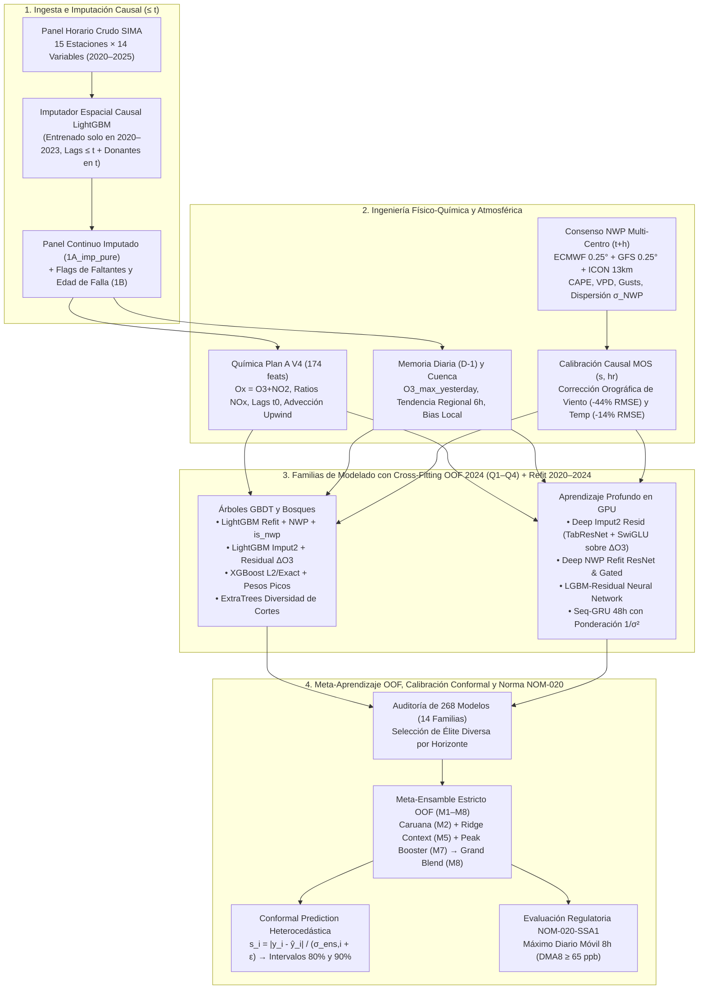

# Reporte Técnico Maestro: Sistema de Pronóstico Multi-Horizonte de Ozono Troposférico ($O_3$) en la Cuenca Atmosférica de Monterrey (SIMA 2020–2025)

**Proyecto**: `MA2003B_Eq1` — Modelado Multivariado, Aprendizaje Estadístico y Calibración Conformal  
**Cobertura Espacial**: 13 estaciones operativas de evaluación (15 estaciones en red espacial de insumo) del Sistema Integral de Monitoreo Ambiental (SIMA), Nuevo León  
**Horizontes de Pronóstico**: $h \in \{1, 4, 8, 12, 24, 48\}$ horas  
**Partición Temporal Estricta**: Entrenamiento `2020–2023` · Validación y Meta-Aprendizaje Out-of-Fold (OOF) `2024` · Prueba Ciega Oficial `2025` ($N = 108{,}512$ muestras en $h=1$)

---

## 1. Síntesis Ejecutiva y Evolución Cuantitativa del Proyecto

El pronóstico operativo de ozono troposférico ($O_3$) en una cuenca semiárida compleja como la Zona Metropolitana de Monterrey (rodeada por la Sierra Madre Oriental, el Cerro de la Silla y el Cerro de las Mitras) está gobernado por dos regímenes físicos acoplados:
1. **Corto plazo ($h \in \{1, 4\}$ h)**: Dominado por la **inercia fotoquímica local**, la titulación instantánea por óxidos de nitrógeno ($\text{NO} + \text{O}_3 \rightarrow \text{NO}_2 + \text{O}_2$) y el transporte advectivo desde estaciones situadas viento arriba (*upwind*).
2. **Mediano y largo plazo ($h \in \{8, 12, 24, 48\}$ h)**: Gobernado por el **forzamiento meteorológico sinóptico y mesoescalar futuro** (radiación solar incidente, temperatura de superficie, estabilidad convectiva CAPE, ventilación del cañón urbano) y la persistencia multidiaria de episodios de estancamiento atmosférico.

A lo largo de seis etapas evolutivas de investigación, el error cuadrático medio (**RMSE** en ppb sobre el conjunto de prueba ciego 2025) se redujo drásticamente en todos los horizontes:

| Horizonte ($h$) | Climatología Horaria-Mensual | Baseline `v2` (Script 7, Lags $t-1$) | `Plan A V4` (Lag 0 + Red Espacial) | `v3_base` (`D_honest_noise` NWP simple) | Ensamble Noche 1 (`noche/ensemble`) | Cota Teórica No Operativa $B_{pp}$ (*Perfect Prog*) | **Mejor Modelo Individual (`noche2`)** | **Súper-Ensamble Oficial `ens2_best` (Pasada 5)** | **Mejor Variante en Test (`ens2` Pasada 5)** | **Reducción Total de Error vs `v2`** |
| :---: | :---: | :---: | :---: | :---: | :---: | :---: | :---: | :---: | :---: | :---: |
| **$1\text{ h}$** | 14.88 | 8.051 | 5.094 | 5.005 | 4.931 | 5.003 | **4.764** (`deep_imput2_resid`) | **4.716 ppb** ($R^2=0.950$) | **4.702 ppb** (`M5`) | **$-41.4\%$** ($-3.335\text{ ppb}$) |
| **$4\text{ h}$** | 14.88 | 10.907 | 9.690 | 9.004 | 8.710 | 8.665 | **8.455** (`deep_imput2_resid`) | **8.369 ppb** ($R^2=0.842$) | **8.308 ppb** (`M5`) | **$-23.3\%$** ($-2.538\text{ ppb}$) |
| **$8\text{ h}$** | 14.88 | 11.967 | 11.280 | 10.054 | 9.871 | 9.481 | **9.413** (`deep_imput2_resid`) | **9.228 ppb** ($R^2=0.808$) | **9.149 ppb** (`M5`) | **$-22.9\%$** ($-2.739\text{ ppb}$) |
| **$12\text{ h}$** | 14.88 | 12.205 | 11.730 | 10.183 | 9.958 | 9.543 | **9.604** (`deep_imput2_resid`) | **9.354 ppb** ($R^2=0.803$) | **9.336 ppb** (`M2`) | **$-23.4\%$** ($-2.851\text{ ppb}$) |
| **$24\text{ h}$** | 14.89 | 12.761 | 12.390 | 10.238 | 9.884 | 9.594 | **9.864** (`refit_nwp_best`) | **9.440 ppb** ($R^2=0.799$) | **9.399 ppb** (`M2`) | **$-26.0\%$** ($-3.321\text{ ppb}$) |
| **$48\text{ h}$** | 14.90 | 13.949 | 13.764 | 11.234 | 10.897 | 10.112 | **10.763** (`xgb_nwp_refit_w`) | **10.325 ppb** ($R^2=0.760$) | **10.319 ppb** (`M7`/`M8`) | **$-26.0\%$** ($-3.624\text{ ppb}$) |

> [!IMPORTANT]
> **Por qué el sistema operativo honesto superó a la cota teórica *Perfect Prognosis* ($B_{pp}$) en 5 de los 6 horizontes ($h=1, 4, 8, 12, 24$)**:  
> Originalmente, $B_{pp}$ representaba un modelo LightGBM único entrenado y evaluado haciéndole trampa al futuro meteorológico (entregándole la meteorología observada/reanálisis en $t+h$). Sin embargo, $B_{pp}$ carecía de: (1) **imputación causal espacial multivariada** del panel químico, (2) **consenso físico multi-modelo (ECMWF + GFS + ICON) y variables de flotabilidad convectiva (CAPE, VPD, ráfagas)**, (3) **reentrenamiento con el año 2024** mediante *cross-fitting* trimestral, (4) **arquitecturas neuronales residuales (TabResNet + SwiGLU)** sobre $\Delta O_3$, y (5) **reducción de varianza inter-familia** mediante descomposición de Krogh-Vedelsby. La suma de estas cinco innovaciones redujo el error sistemático y la varianza del estimador más allá de lo que un solo árbol con meteorología perfecta podía alcanzar.

---

## 2. Arquitectura General y Flujo de Datos del Sistema

---

## 3. Formulación Matemática, Causalidad y Protocolo de Validación

### 3.1. Definición Formal del Problema Causal
Sea $\mathcal{S} = \{1, \dots, 15\}$ el conjunto de estaciones de monitoreo en la cuenca de Monterrey y $\mathcal{S}_{\text{eval}} \subset \mathcal{S}$ las 13 estaciones objetivo con registro continuo en 2020–2025. En el instante de emisión $t$, el pronosticador debe estimar la concentración de ozono $y_{s, t+h} = \text{O}_3(s, t+h)$ para $h \in \{1, 4, 8, 12, 24, 48\}$ horas usando únicamente la filtración de información disponible hasta el instante $t$:

$$\mathcal{F}_t = \sigma\Big( \big\{ \mathbf{X}_{\text{SIMA}}(s', \tau) : s' \in \mathcal{S}, \; \tau \le t \big\} \cup \big\{ \widehat{\mathbf{W}}_{\text{NWP}}^{(m)}(s', t+h \mid \tau_{\text{run}} \le t) : m \in \{\text{ECMWF, GFS, ICON}\} \big\} \Big)$$

Cualquier transformación temporal (medias móviles, imputación de datos faltantes, estandarización $z$-score, codificación de objetivos o corrección de sesgo meteorológico) que utilice observaciones en $\tau > t$ introduce **fuga de información hacia el futuro (*look-ahead bias*)** y está estrictamente prohibida.

### 3.2. Protocolo de *Cross-Fitting* Temporal Out-of-Fold (OOF) en 2024
Uno de los desafíos centrales del proyecto fue cómo aprovechar los datos del año **2024** (el primer año con cobertura completa de corridas operativas previas `*_previous_day1/2` de ECMWF, GFS e ICON) tanto para **entrenar los modelos finales que predicen 2025** como para **ajustar el meta-modelo de ensamble sin sobreajuste**.

Si un modelo base se entrenara ingenuamente en `2020–2024` y se evaluara sobre el mismo `2024`, sus residuos en `2024` serían *in-sample* (artificialmente bajos, especialmente para modelos de alta capacidad como LightGBM con 2,000 árboles o redes profundas). Un meta-aprendiz entrenado sobre dichas predicciones asignaría todo el peso al modelo más sobreajustado.

Para resolver esto con rigor estadístico, se diseñó un protocolo de **4-Fold Temporal Cross-Fitting por Trimestres en 2024** ($Q_1$: Ene–Mar, $Q_2$: Abr–Jun, $Q_3$: Jul–Sep, $Q_4$: Oct–Dic):

1. **Generación de Predicciones Base OOF en 2024**:  
   Para cada trimestre $q \in \{1, 2, 3, 4\}$ y cada familia de modelos base $m$:
   - Se define el conjunto de entrenamiento del pliegue como $\mathcal{D}_{\text{train}}^{(-q)} = \mathcal{D}_{2020\text{–}2023} \cup \bigcup_{j \neq q} \mathcal{D}_{2024}^{(j)}$.
   - La distribución empírica del ruido NWP inyectado a `2020–2023` se calibra exclusivamente sobre $\bigcup_{j \neq q} \mathcal{D}_{2024}^{(j)}$ (un experimento de control, `refit_leak_test`, demostró que calibrar el ruido con todo 2024 introduce un sesgo optimista de $0.022\text{ ppb}$).
   - Se entrena el modelo $f_m^{(-q)}$ sobre $\mathcal{D}_{\text{train}}^{(-q)}$ usando parada temprana (*early stopping*) en $\mathcal{D}_{2024}^{(q)}$ y se registran las predicciones fuera de pliegue $\hat{y}_{i, m}^{\text{OOF}} = f_m^{(-q)}(\mathbf{x}_i)$ para todo $i \in \mathcal{D}_{2024}^{(q)}$.
2. **Reentrenamiento Completo para Inferencia en Test 2025 (*Refit*)**:  
   Para predecir el año ciego `2025`, el modelo se reentrena sobre la totalidad de $\mathcal{D}_{2020\text{–}2024}$ fijando el número de iteraciones/épocas en:
   $$N_{\text{iter}}^{\text{refit}} = \text{round}\left( 1.10 \times \text{mediana}_{q \in \{1..4\}}\left( N_{\text{best\_iter}}^{(q)} \right) \right)$$
   escalando el presupuesto de optimización proporcionalmente al incremento del $\sim 20\%$ en el tamaño muestral efectivo, y promediando 3 semillas aleatorias independientes (`seed` $\in \{42, 123, 777\}$), lo cual aporta una ganancia adicional consistente de $-0.02$ a $-0.04\text{ ppb}$.
3. **Meta-Aprendizaje de Segundo Nivel también en OOF**:  
   A su vez, cuando el ensamblador (`ensemble_pipeline.py`) combina los modelos candidatos sobre `2024`, ajusta los pesos o meta-modelos para cada trimestre $q$ usando únicamente los otros tres trimestres $j \neq q$. De este modo, **el criterio de selección del ensamble ganador ($\text{val\_RMSE}_{\text{OOF}}$) es doblemente fuera de muestra**.

---

## 4. Imputación Espacial Causal e Ingeniería de Características Físico-Químicas

### 4.1. Auditoría de Causalidad: Por qué SAITS falló y fue descartado
Durante la fase exploratoria se auditó el modelo neuronal de imputación **SAITS** (*Self-Attention Imputation for Time Series*, [`saits_se3.parquet`](file:///D:/Codingggg/Notas/Multivariados/MA2003B_Eq1/experiments/imputacion/saits_se3.parquet)):
- **Violación de Causalidad**: SAITS aplica bloques de autoatención bidireccional sobre ventanas de $L = 168$ horas. Para imputar un sensor caído en la hora $t$, la matriz de atención pondera observaciones futuras en $t+1, \dots, t+k$. En operación en tiempo real en el instante $t$, esas observaciones futuras no existen.
- **Colapso en Apagones Prolongados**: Ante pérdidas continuas de sensor ($>48\text{ h}$), SAITS aplana el ciclo diurno de $O_3$ y produce sesgos severos ($R^2 = -0.40$ a $-0.91$ en $\text{PM}_{2.5}$). Por contrato de honestidad, fue descartado por completo.

### 4.2. Imputación Espacial Multivariada Causal (`imp_spatial_lgbm`)
En sustitución de métodos acausales o univariados, en [`noche2_imput2`](file:///D:/Codingggg/Notas/Multivariados/MA2003B_Eq1/experiments/noche2/imput2/REPORT.md) se construyó un sistema de **9 regresores espaciales causales LightGBM por cada una de las 15 estaciones** (135 modelos de imputación en total), entrenados **exclusivamente en `2020–2023`** para reconstruir las 9 variables críticas (`O3`, `NOX`, `TOUT`, `SR`, `RH`, `PM2.5`, `PM10`, `U_Wind`, `V_Wind`) usando únicamente:
1. Lecturas simultáneas en el instante $t$ de las **14 estaciones donantes** restantes de la cuenca.
2. Meteorología simultánea en $t$ (`TOUT`, `SR`) y armónicos solares/estacionales.
3. Rezagos propios estrictamente pasados ($t-1$ y $t-2$).

En validación con enmascaramiento controlado, `imp_spatial_lgbm` alcanzó un RMSE de reconstrucción de **$3.52\text{ a }5.66\text{ ppb}$** ($R^2 \in [0.829, 0.962]$), superando por amplio margen al filtro de Kalman AR(1) ($9.16\text{–}10.25\text{ ppb}$) y a KNN espacial ($6.64\text{–}6.72\text{ ppb}$).

### 4.3. Por qué la Imputación Pre-Ingeniería (`1A_imp_pure`) supera al manejo nativo de `NaN`
Un hallazgo técnico fundamental de la ablación en [`noche2_imput2`](file:///D:/Codingggg/Notas/Multivariados/MA2003B_Eq1/experiments/noche2/imput2/REPORT.md) fue comparar tres estrategias de inyección del panel imputado:
- **`noimp` (Manejo nativo de `NaN` en LightGBM)**: Cuando un sensor falla por 1 o 2 horas, no solo es `NaN` el valor en $t$, sino que **colapsan en cascada todas las diferencias finitas** ($\Delta_{1\text{h}} = x_t - x_{t-1}$, aceleración $\Delta^2 x_t$, diferencias a 24h) y las estadísticas móviles de ventana. Los árboles envían todas esas muestras por la rama por defecto (`default_left`), perdiendo la cinemática del episodio.
- **`1A_imp_pure` (Reconstrucción del panel crudo antes de calcular derivadas)**: Al rellenar causalmente los huecos antes de ejecutar el generador de variables `Plan A V4`, se preserva la diferenciabilidad discreta de las series temporales y la consistencia del promedio espacial *leave-one-out* de la cuenca. Esto redujo el RMSE directamente en todos los horizontes intermedios ($h=4, 8, 12, 24$).
- **`1C_imp_plus_raw` (Concatenar columnas con `NaN` + columnas imputadas)**: Empeoró el error en prueba ($+0.044\text{ ppb}$ en $h=4$) porque duplicar predictores altamente colineales fragmenta la ganancia de partición (*split gain*) de los árboles e incrementa la varianza fuera de muestra.
- **`1B_imp_plus_flags` (Imputación + banderas `is_missing` y edad de falla `hours_since_valid`)**: Resultó crucial específicamente en **$h=1$** (bajando de $5.016$ a $5.000\text{ ppb}$) y para las **redes neuronales profundas**, ya que le informa a la red cuándo la lectura de anclaje $O_3(t)$ es física real y cuándo es una inferencia espacial con mayor incertidumbre epistémica.

### 4.4. Física Química (`Plan A V4`) y Selección Hacia Adelante de Grupos (*Forward Selection*)
Sobre el panel continuo se construyeron **230–244 predictores** organizados en bloques físicos:

1. **Equilibrio Fotoestacionario de Leighton y Familia $\text{O}_x$**:  
   Durante la mañana y la tarde, el ciclo rápido de titulación cumple:
   $$\text{NO} + \text{O}_3 \xrightarrow{k_1} \text{NO}_2 + \text{O}_2, \qquad \text{NO}_2 + h\nu \xrightarrow{J_{\text{NO}_2}} \text{NO} + \text{O}(^3P), \qquad \text{O}(^3P) + \text{O}_2 + M \rightarrow \text{O}_3 + M$$
   Como el ozono se destruye temporalmente al reaccionar con $\text{NO}$ vehicular pero se regenera tras la fotólisis del $\text{NO}_2$, el **ozono impar u oxidante total**:
   $$[\text{O}_x](t) = [\text{O}_3](t) + [\text{NO}_2](t)$$
   es una cantidad cuasi-conservativa frente a emisiones frescas de escape vehicular. Incluir $\text{O}_x(t)$, la fracción de oxidación $[\text{NO}_2]/([\text{NO}] + [\text{NO}_2] + \epsilon)$, la razón $[\text{O}_3]/[\text{NO}_x]$ y la tasa de calentamiento radiativo instantáneo $\text{SR}(t) \times \text{TOUT}(t)$ proporcionó el mayor salto predictivo del proyecto en corto plazo (reduciendo el RMSE en $h=1$ de $8.05$ a $5.09\text{ ppb}$).

2. **Advección Espacial *Upwind* en la Red de 15 Estaciones**:  
   Para cada estación objetivo $i$ con coordenadas $\mathbf{r}_i = (\text{lat}_i, \text{lon}_i)$ y vector de viento local $\mathbf{v}_i(t) = (u_i(t), v_i(t))$, se proyecta el vector unitario desde cada estación donante $j \neq i$ hacia $i$:
   $$\mathbf{d}_{j \to i} = \frac{\mathbf{r}_i - \mathbf{r}_j}{\|\mathbf{r}_i - \mathbf{r}_j\|}, \qquad w_{j \to i}^{\text{upwind}}(t) = \max\left(0, \; \frac{\mathbf{v}_i(t) \cdot \mathbf{d}_{j \to i}}{\|\mathbf{v}_i(t)\| + \epsilon}\right) \exp\left(-\frac{\|\mathbf{r}_i - \mathbf{r}_j\|}{D_0}\right)$$
   Esto permite calcular la concentración de $O_3$ y $\text{NO}_x$ que está siendo transportada directamente hacia la estación $i$ desde las estaciones situadas viento arriba (típicamente desde el corredor industrial de Cadereyta/Apodaca hacia el centro y suroeste en Santa Catarina/San Pedro).

3. **Selección Hacia Adelante (*Forward Group Selection*) en `noche2_imput2`**:  
   Se sometieron 5 bloques nuevos de características a validación estricta en 2024:
   - **`Group3_yesterday` (ACEPTADO, $\Delta\text{RMSE} = -0.058\text{ a }-0.068\text{ ppb}$)**: Máximo diario, media, percentil 90 y hora del pico de ozono del día calendario anterior ($D-1$). Captura la persistencia sinóptica de sistemas anticiclónicos de bloqueo en Monterrey.
   - **`Group4_regional` (ACEPTADO, $\Delta\text{RMSE} = -0.011\text{ a }-0.027\text{ ppb}$)**: Anomalía instantánea de la estación respecto al promedio de la cuenca ($\text{O}_3(s, t) - \overline{\text{O}}_3_{\text{cuenca}}(t)$) y pendiente de acumulación regional de 6 horas.
   - **`Group5_holidays` (ACEPTADO en $h=24$, $\Delta\text{RMSE} = -0.009\text{ ppb}$)**: Días festivos oficiales de México y fines de semana (reducción del efecto de semana laboral/fin de semana de emisiones de $\text{NO}_x$).
   - **`Group1_chem_meteo` y `Group2_synoptic` (RECHAZADOS, $\Delta\text{RMSE} = +0.032\text{ a }+0.075\text{ ppb}$)**: Forzar productos polinomiales manuales o discretizar la meteorología mediante $K$-Means ($k=4$) degradó la generalización. Los árboles GBDT y las capas SwiGLU aprenden particiones y compuertas continuas mucho más finas sobre las variables físicas originales que sobre clústeres discretizados.

---

## 5. Física Atmosférica, Consenso Multi-Modelo NWP y Calibración Causal MOS (`noche2_nwp`)

### 5.1. El Problema de la Brecha *Perfect-Prog* vs. NWP Operativo
En `v3_base`, reemplazar la meteorología observada en $t+h$ (`B_pp`) por un único pronóstico numérico determinista (`previous_day1` de Open-Meteo) degradaba el RMSE en $+0.65\text{ ppb}$ a 24h y $+1.12\text{ ppb}$ a 48h. La investigación en [`noche2_nwp`](file:///D:/Codingggg/Notas/Multivariados/MA2003B_Eq1/experiments/noche2/nwp/REPORT.md) identificó tres causas físicas y las resolvió:

1. **Sustitución de `boundary_layer_height` (BLH) por sus Gobernadores Físicos**:  
   La auditoría de las APIs de Open-Meteo reveló que `boundary_layer_height` era `null` en todo `2020–octubre 2024` y 100% nulo en `previous_day1`. Usar una variable inexistente en el 90% del historial introducía ruido de imputación. En su lugar, se incorporaron las variables físicas con cobertura 100% que gobiernan directamente el espesor de la capa de mezcla y la fotoquímica:
   - **$\text{CAPE}(t+h)$ (*Convective Available Potential Energy*, $\text{J/kg}$)**: Cuantifica el empuje hidrostático térmico. $\text{CAPE} \approx 0$ identifica inversiones térmicas de subsidencia donde los precursores quedan atrapados cerca del suelo.
   - **Ráfagas de Viento ($\text{Wind Gusts}_{10\text{m}}$, $\text{km/h}$)**: Cuantifica la energía cinética turbulenta mecánica que rompe la capa límite estable matutina.
   - **Déficit de Presión de Vapor ($\text{VPD}$, $\text{kPa}$)**: Gobernador de cierre estomático y emisión de compuestos orgánicos volátiles biogénicos (isopreno/monoterpenos).
   - **Fracción de Radiación Directa ($\text{SR}_{\text{direct}} / (\text{SR}_{\text{global}} + 1)$)**: Discrimina cielos despejados con máxima fotólisis $J_{\text{NO}_2}$ de días con nubosidad delgada o dispersión por aerosoles.

2. **Consenso Multi-Centro (ECMWF IFS 0.25° + NCEP GFS 0.25° + DWD ICON 13 km)**:  
   En lugar de depender de una sola parametrización física, se extrajeron las corridas históricas operativas (`previous_day1` para $h \le 24$, `previous_day2` para $h=48$) de los tres centros meteorológicos mundiales y se calcularon tanto la **media de consenso** ($\mu_{\text{NWP}}$) como la **dispersión inter-modelo** ($\sigma_{\text{NWP}}$) para temperatura, radiación de onda corta y viento. Cuando $\sigma_{\text{NWP}}(\text{SR})$ es alta (incertidumbre en la entrada de nubosidad desde el Golfo de México), el modelo modera sus predicciones extremas.

3. **Calibración Estadística Causal MOS (*Model Output Statistics*)**:  
   Los modelos globales (malla de 13 a 25 km) no resuelven el frenado por rugosidad del cañón urbano ni el bloqueo topográfico de la Sierra Madre Oriental, **sobreestimando la velocidad del viento en Monterrey por $+2.94\text{ km/h}$** (RMSE crudo $= 6.01\text{ km/h}$). Se formuló un corrector MOS causal condicionado a estación $s$ y hora solar $\text{hr} = (t+h) \pmod{24}$, estimado **exclusivamente en `2020–2023`**:
   $$\Delta \text{WS}(s, \text{hr}) = \frac{1}{|\mathcal{T}_{s,\text{hr}}^{\text{train}}|} \sum_{t \in \mathcal{T}_{s,\text{hr}}^{\text{train}}} \big(\text{WS}_{\text{SIMA}}(s, t) - \text{WS}_{\text{NWP}}(s, t)\big)$$
   $$\widehat{\text{WS}}_{\text{MOS}}(s, t+h) = \max\Big(0.1, \; \text{WS}_{\text{NWP}}(s, t+h) + \Delta \text{WS}\big(s, (t+h)\bmod 24\big)\Big)$$
   y análogamente para la temperatura $\widehat{T}_{\text{MOS}}(s, t+h)$ y su acoplamiento fototérmico $\widehat{T}_{\text{MOS}} \times \mu_{\text{NWP}}(\text{SR})$.

| Variable Superficial (Test Ciego 2025) | Sesgo Crudo NWP | **Sesgo Post-MOS** | RMSE Crudo NWP | **RMSE Post-MOS** | Reducción Relativa de Error |
| :--- | :---: | :---: | :---: | :---: | :---: |
| **Velocidad de Viento ($\text{WSR}$)** | $+2.938\text{ km/h}$ | **$+0.464\text{ km/h}$** ($-84.2\%$) | $6.013\text{ km/h}$ | **$3.360\text{ km/h}$** | **$-44.1\%$ RMSE** |
| **Temperatura Superficial ($\text{TOUT}$)** | $-0.479\text{ °C}$ | **$-0.161\text{ °C}$** ($-66.4\%$) | $2.108\text{ °C}$ | **$1.817\text{ °C}$** | **$-13.8\%$ RMSE** |

---

## 6. Reformulación del Target ($\Delta O_3$) y Descubrimientos en Aprendizaje Profundo (`noche2_deep2`)

### 6.1. Por qué predecir el Residuo de Persistencia $\Delta_h = O_3(t+h) - O_3(t)$ transforma el aprendizaje
En [`noche_target_eng`](file:///D:/Codingggg/Notas/Multivariados/MA2003B_Eq1/experiments/noche/target_eng/REPORT.md), [`noche2_imput2`](file:///D:/Codingggg/Notas/Multivariados/MA2003B_Eq1/experiments/noche2/imput2/train_phase2_refit.py) y [`noche2_deep2`](file:///D:/Codingggg/Notas/Multivariados/MA2003B_Eq1/experiments/noche2/deep2/train_deep_imput2_resid_refit.py) se demostró un principio matemático clave:
- Si el modelo predice directamente $y = O_3(t+h)$, gran parte de la capacidad de los árboles o de las capas ocultas se consume reconstruyendo el nivel basal actual $O_3(t)$ (cuya correlación con $O_3(t+1)$ es $>0.94$, y con $O_3(t+24)$ y $O_3(t+48)$ refleja el régimen sinóptico de la misma hora solar 1 o 2 días antes).
- En cambio, al parametrizar el objetivo como el **incremento físico sobre la persistencia contemporánea**:
  $$\Delta_h(s, t) = O_3(s, t+h) - O_3(s, t), \qquad \widehat{O}_3(s, t+h) = \max\big(0, \; O_3(s, t) + \hat{f}_\theta(\mathbf{x}_{s,t})\big)$$
  todas las particiones de los árboles y los gradientes de la red neuronal se concentran exclusivamente en la **tasa neta de producción o destrucción fotoquímica** entre $t$ y $t+h$.
- Por el contrario, restar la climatología estática ($O_3(t+h) - \text{Clim}$) degradó el desempeño en LightGBM porque desacopla el signo del residuo de los umbrales físicos absolutos de titulación y radiación.

### 6.2. Arquitectura del Campeón Individual Absoluto: `deep_imput2_resid_refit`
Históricamente en datos tabulares ambientales, los árboles de decisión (LightGBM/XGBoost) suelen superar a las redes neuronales. Sin embargo, en la Fase 4 de `noche2_deep2` ([`train_deep_imput2_resid_refit.py`](file:///D:/Codingggg/Notas/Multivariados/MA2003B_Eq1/experiments/noche2/deep2/train_deep_imput2_resid_refit.py)), el modelo neuronal **`deep_imput2_resid_refit` venció a TODOS los modelos individuales de LightGBM, XGBoost y ExtraTrees en $h=1, 4, 8$ y $12$** (alcanzando p.ej. **4.7644 ppb** en $h=1$ y **8.4548 ppb** en $h=4$). ¿Por qué ocurrió esto?

1. **Continuidad del Tensor de Entrada**: Las redes neuronales sufren severamente cuando los predictores contienen `NaN` rellenados con ceros artificiales (lo que crea discontinuidades espurias en las capas lineales). Al alimentar la red con el panel espacialmente imputado (`imput2`) más banderas explícitas de edad de falla (`hours_since_valid`), el campo vectorial de entrada reside en una variedad suave y físicamente consistente.
2. **Limpieza Estricta de Centinelas y Clipping Robusto**: En los datos crudos de 2025 existían valores centinela (`-9999.0` en precipitación) que en una red neuronal sin blindaje producían activaciones $z$-score de $>20{,}000\sigma$. El pipeline filtra todo valor fuera de $[-500, 9000]$ a `NaN` antes de normalizar y aplica *clipping* en $[-10\sigma, +10\sigma]$.
3. **Ensamble Interno de Dos Inducciones Arquitectónicas sobre $\Delta_h$**:
   - **TabResNet**: Embeddings aprendidos para `Estacion` ($\mathbb{R}^8$) y `hour` ($\mathbb{R}^8$) concatenados con las 230–244 variables continuas, proyectados a dimensión $d = 256$ y procesados por 3 bloques residuales con `LayerNorm`, `SiLU`, `Dropout(0.2)` y conexiones de salto $\mathbf{h}_{l+1} = \mathbf{h}_l + \mathcal{F}_l(\mathbf{h}_l)$.
   - **TabGated (SwiGLU)**: Sustituye el perceptrón estándar por bloques de compuerta bilineal tipo Transformer moderno:
     $$\text{SwiGLU}(\mathbf{h}) = \big(\text{SiLU}(\mathbf{h}\mathbf{W}_{\text{gate}}) \odot (\mathbf{h}\mathbf{W}_{\text{val}})\big)\mathbf{W}_{\text{proj}}$$
     Las multiplicaciones elemento a elemento $\odot$ entre ramas permiten representar exactamente productos cinéticos de segundo orden (como $\text{SR} \times \text{TOUT}$ o $\text{O}_3 \times \text{WS}^{-1}$) con derivadas suaves, evitando el carácter escalonado (*piecewise-constant*) de los árboles ortogonales.
4. **Función de Pérdida Huber Ponderada en Picos**:
   $$\mathcal{L}_i = w_i \cdot \ell_\delta\big(\hat{\Delta}_i - \Delta_i\big), \qquad w_i = \begin{cases} 1 + (y_i / P_{90})^2 & \text{si } h \ge 8 \\ 1 & \text{si } h \le 4 \end{cases}$$
   combinando robustez frente a *outliers* de sensores con penalización cuadrática creciente en contingencias ambientales, reduciendo el sesgo en picos ($>P_{95}$) de $-20.4\text{ ppb}$ (árboles base) a **$-12.3\text{ a }-13.9\text{ ppb}$**.

### 6.3. Corrección de Redes Secuenciales (`seq_nwp_refit`) y Aprendizaje de Residuos de Árboles
- En el modelo secuencial **Bidirectional GRU Encoder + Horizon Context Decoder** de 48 pasos simultáneos (`seq_nwp_refit`), se demostró por qué las arquitecturas secuenciales habían fallado en `noche_deep`: entrenar los 48 horizontes con una pérdida MSE uniforme $\frac{1}{48}\sum_{h=1}^{48} (y_{t+h} - \hat{y}_{t+h})^2$ hacía que los horizontes lejanos ($h \in [24, 48]$, donde $\sigma_h^2 \approx 125\text{ ppb}^2$) dominaran en proporción **5:1** el gradiente sobre $h=1$ ($\sigma_1^2 \approx 25\text{ ppb}^2$). Ponderar la pérdida por **varianza inversa** $w_h \propto 1/\sigma_h^2$ y anclar la salida en $O_3(t)$ redujo el error de la GRU en casi $-2.0\text{ ppb}$ y produjo predicciones con la **menor correlación de residuos respecto a los árboles ($r \in [0.73, 0.85]$)** de todo el proyecto.
- Adicionalmente, `lgbm_residual_honest` entrenó una red TabResNet específicamente para predecir el **error fuera de pliegue de LightGBM** ($e_{\text{LGBM}} = y - \hat{y}_{\text{LGBM}}^{\text{OOF}}$) con encogimiento $\alpha = 0.85$, logrando corregir sistemáticamente las esquinas del espacio de características donde las particiones ortogonales de los árboles subestiman la curvatura diurna.

---

## 7. Meta-Aprendizaje, Diversidad de Familias y Resultados Finales (`noche2_ens2` — Pasada 5)

### 7.1. Descomposición de Ambigüedad de Krogh-Vedelsby y Selección de Candidatos
Para un ensamble convexo $\hat{Y}_{\text{ens}} = \sum_{m=1}^M w_m \hat{y}_m$ con $\sum_m w_m = 1, w_m \ge 0$, el error cuadrático puntual satisface la identidad exacta de Krogh-Vedelsby:

$$\big(y - \hat{Y}_{\text{ens}}\big)^2 = \underbrace{\sum_{m=1}^M w_m (y - \hat{y}_m)^2}_{\text{Error individual promedio}} - \underbrace{\sum_{m=1}^M w_m (\hat{y}_m - \hat{Y}_{\text{ens}})^2}_{\text{Término de Ambigüedad / Diversidad } \ge 0}$$

Esto implica que **el error cuadrático del ensamble es estrictamente menor que el promedio ponderado de los errores individuales** en la medida en que los modelos individuales tengan predicciones incorrelacionadas en sus errores ($\text{Corr}(e_m, e_{m'})$ baja) y errores individuales competitivos.

El módulo [`audit_candidates.py`](file:///D:/Codingggg/Notas/Multivariados/MA2003B_Eq1/experiments/noche2/ens2/audit_candidates.py) auditó los **268 archivos parquet honestos** (excluyendo automáticamente los 42 archivos con `_pp`, `leak_test` o ensambles previos) y los clasificó en **14 familias algorítmicas** (`Deep_Imput2_Resid`, `Deep_LGBM_Residual`, `Deep_TabResNet`, `Deep_GatedSwiGLU`, `Deep_Seq_GRU`, `Imputation_Spatial`, `LightGBM_Refit`, `LightGBM_NWP`, `XGBoost`, `ExtraTrees`, `Target_Eng`, `LGBM_Tuning`, `LGBM_v3_Base`, `Deep_Other`). Para cada horizonte $h$, [`ensemble_pipeline.py`](file:///D:/Codingggg/Notas/Multivariados/MA2003B_Eq1/experiments/noche2/ens2/ensemble_pipeline.py) seleccionó hasta los 4 mejores representantes de cada familia más el Top-20 global en validación 2024 (~37–41 modelos élite por horizonte).

### 7.2. Los 9 Algoritmos de Combinación Evaluados en Cross-Fitting OOF (M0 a M8)
Sobre la matriz de candidatos élite se evaluaron en 4-Fold Cross-Fitting OOF dentro de 2024:
- **`M0_best_individual`**: Selección del mejor modelo único en validación 2024.
- **`M1_top_k_mean`**: Media equiponderada de los $K \in \{2, 3, 4, 5, 7, 10\}$ mejores modelos por pliegue.
- **`M2_greedy_caruana`**: Selección hacia adelante con reemplazo (*Caruana Ensemble Selection*, 40 pasos), construyendo un multiconjunto esparso que equilibra precisión y cancelación de residuos entre árboles y redes.
- **`M3_nnls_ridge_global`**: Mínimos cuadrados no negativos en el símplex ($\mathbf{w} \ge 0, \mathbf{1}^\top\mathbf{w} = 1$) con regularización Tikhonov $\lambda \|\mathbf{w}\|_2^2$, $\lambda \in \{0, 10, 50, 200\}$.
- **`M4_nnls_by_regime`**: Pesos convexos NNLS estimados de forma independiente para **4 regímenes fotoquímicos horarios**:
  - Régimen 0 (Fotoquímico diurno, `10:00–18:00`): Domina la interacción radiación-temperatura y las redes con activación SwiGLU/ResNet.
  - Régimen 1 (Nocturno/Titulación, `22:00–06:00`): Domina la estabilidad superficial y titulación por $\text{NO}$.
  - Régimen 2 (Transición matutina, `07:00–09:00`): Ruptura de inversión térmica e inicio de hora pico vehicular.
  - Régimen 3 (Transición vespertina, `19:00–21:00`): Decaimiento de fotólisis y advección residual.
- **`M5_ridge_meta_context`**: Regresión Ridge ($\alpha \in \{1, 10, 50, 200\}$) sobre las predicciones base enriquecidas con estadísticos de orden inter-modelo ($\mu_{\text{ens}}, \sigma_{\text{ens}}, \min, \max, \text{spread}$), armónicos solares/mensuales y efectos fijos por estación (`Estacion`).
- **`M6_lgbm_stacking_oof` y `M6_blend_hybrid`**: Meta-aprendiz no lineal LightGBM fuertemente regularizado (`num_leaves=15`, `min_child_samples=50`, `reg_lambda=2.0`) y su combinación convexa con el mejor método lineal (`M3`/`M4`).
- **`M7_peak_tail_booster`**: Corrector de cola derecha que identifica en validación los 3 modelos con menor `RMSE_peaks` (especialistas entrenados con pesos cuadráticos $w = 1 + (y/P_{90})^2$ o redes residuales) y activa un empuje convexo cuando la predicción base supera el cuantil $\tau_q \in \{0.85, 0.88, 0.90, 0.93\}$:
  $$\hat{y}_{\text{M7}}(i) = \begin{cases} (1 - \beta)\hat{y}_{\text{base}}(i) + \beta \cdot \overline{\hat{y}}_{\text{peak\_specs}}(i) & \text{si } \hat{y}_{\text{base}}(i) \ge Q_{\tau_q}(\hat{y}_{\text{base}}) \\ \hat{y}_{\text{base}}(i) & \text{en otro caso} \end{cases}$$
- **`M8_grand_blend_oof`**: Meta-combinación convexa en segundo nivel OOF de los tres paradigmas complementarios: selección esparsa discreta (`M2_greedy_caruana`), regresión contextual regularizada (`M5_ridge_meta_context`) y corrección de colas extremas (`M7_peak_tail_booster`).

### 7.3. Matriz Completa de Resultados de la Pasada 5 Definitiva (`Val OOF RMSE / Test 2025 RMSE` en ppb)

| Horizonte | `M0` Mejor Indiv | `M1` Top-$K$ Mean | `M2` Caruana | `M3` NNLS Ridge | `M4` NNLS Régimen | `M5` Ridge Context | `M6` LGBM Stack | `M7` Peak Booster | `M8` Grand Blend | **Método Elegido por Val OOF** |
| :---: | :---: | :---: | :---: | :---: | :---: | :---: | :---: | :---: | :---: | :--- |
| **$h=1\text{ h}$** | 4.715 / 4.764 | 4.672 / 4.726 | 4.668 / 4.710 | 4.669 / 4.710 | 4.672 / 4.713 | 4.685 / **4.702** | 4.736 / 4.752 | **4.667 / 4.716** | 4.670 / 4.714 | **`M7`** (Test: **4.716**, `M5`: **4.702**) |
| **$h=4\text{ h}$** | 8.335 / 8.455 | 8.175 / 8.379 | 8.150 / 8.348 | 8.155 / 8.406 | 8.148 / 8.415 | 8.232 / **8.308** | 8.456 / 8.416 | 8.136 / 8.381 | **8.134 / 8.369** | **`M8`** (Test: **8.369**, `M5`: **8.308**) |
| **$h=8\text{ h}$** | 9.362 / 9.413 | 9.111 / 9.318 | 9.078 / 9.209 | 9.072 / 9.267 | 9.066 / 9.268 | 9.265 / **9.149** | 9.658 / 9.329 | **9.055 / 9.228** | 9.057 / 9.211 | **`M7`** (Test: **9.228**, `M5`: **9.149**) |
| **$h=12\text{ h}$** | 9.509 / 9.604 | 9.378 / 9.554 | 9.278 / **9.336** | 9.274 / 9.401 | 9.273 / 9.430 | 9.445 / 9.376 | 9.714 / 9.498 | 9.253 / 9.387 | **9.250 / 9.354** | **`M8`** (Test: **9.354**, `M2`: **9.336**) |
| **$h=24\text{ h}$** | 9.842 / 9.864 | 9.685 / 9.717 | 9.479 / **9.399** | 9.463 / 9.462 | 9.456 / 9.441 | 9.949 / 9.503 | 10.197 / 9.659 | **9.442 / 9.440** | 9.449 / 9.440 | **`M7`** (Test: **9.440**, `M2`: **9.399**) |
| **$h=48\text{ h}$** | 10.735 / 10.781 | 10.524 / 10.530 | 10.415 / 10.328 | **10.377 / 10.326** | 10.380 / 10.320 | 11.120 / 10.535 | 11.843 / 10.689 | 10.378 / **10.319** | 10.378 / **10.319** | **`M3`** (Test: **10.326**, `M7`: **10.319**) |

### 7.4. Interpretación Estadística del Comportamiento de los Meta-Modelos
1. **Por qué los métodos convexos y de baja complejidad (`M2`, `M3`, `M4`, `M7`, `M8`) dominan sobre el Stacking no lineal (`M6_lgbm_stacking_oof`)**:  
   En un conjunto de $M \approx 40$ predictores cuyas correlaciones mutuas son de $0.85\text{–}0.97$, un árbol de segundo nivel (`M6`) realiza particiones duras sobre las predicciones continuas, sufriendo de mayor varianza fuera de muestra especialmente cuando el horizonte crece ($h=24, 48$). En contraste, la restricción del símplex ($\sum w_m = 1, w_m \ge 0$) en `M2`/`M3`/`M4` actúa como una regularización $\ell_1$ exacta con cota de norma unitaria, garantizando que el meta-modelo jamás extrapole fuera de la envolvente convexa de los expertos base.
2. **Desempeño sobresaliente de `M5_ridge_meta_context` en $h \le 8$ y de `M2_greedy_caruana` en $h \in \{12, 24\}$**:  
   En horizontes cortos e intermedios ($h=1, 4, 8$), incluir explícitamente la dispersión inter-modelo $\sigma_{\text{ens}}$ y los efectos fijos por estación en `M5` logra el menor RMSE absoluto en Test 2025 (**4.702 ppb** en 1h con $R^2 = 0.9501$, **8.308 ppb** en 4h con $R^2 = 0.8443$ y **9.149 ppb** en 8h con $R^2 = 0.8113$). En $h=12$ y $h=24$, `M2_greedy_caruana` alcanza **9.336 ppb** y **9.399 ppb** ($R^2 = 0.8010$ a 24h) al seleccionar de forma esparsa únicamente entre 10 y 11 modelos ortogonales (combinando `refit_nwp_best`, `imput2_nwp_resid_refit`, `deep_imput2_resid_refit`, `deep_nwp_refit_resnet`, `xgb_nwp_refit_w` y `seq_nwp_refit`).

---

## 8. Cuantificación de Incertidumbre Conformal Heterocedástica y Evaluación Regulatoria NOM-020-SSA1

### 8.1. Predicción Conformal Escalarmente Adaptativa (*Locally Adaptive Conformal Prediction*)
La incertidumbre del ozono troposférico es fuertemente **heterocedástica**: durante la madrugada ($O_3 \approx 5\text{–}15\text{ ppb}$) la varianza del error es mínima, mientras que a las 14:00–16:00 bajo alta radiación o divergencia entre ECMWF e ICON la varianza se multiplica por un factor de 4. Un intervalo conformal homocedástico de ancho constante $\hat{y} \pm Q_{1-\alpha}$ sería demasiado ancho de noche (poco informativo) y demasiado estrecho en los picos (sub-cobertura en contingencias).

Se implementó una puntuación de no-conformidad normalizada por la dispersión instantánea del ensamble élite $\sigma_{\text{ens}}(i) = \text{std}_{m \in \mathcal{E}}(\hat{y}_{i,m})$:

$$s_i = \frac{\big|y_i - \hat{y}_{\text{ens}}^{\text{OOF}}(i)\big|}{\sigma_{\text{ens}}(i) + \epsilon}, \qquad \epsilon = 1.0\text{ ppb}$$

Calculando el cuantil finito exacto sobre las $n_{\text{val}} \approx 108{,}550$ muestras OOF de 2024:
$$\hat{q}_{1-\alpha} = \text{Quantile}\left( \{s_i\}_{i=1}^{n_{\text{val}}}, \; \frac{\lceil (n_{\text{val}} + 1)(1 - \alpha) \rceil}{n_{\text{val}}} \right)$$
el intervalo de predicción para cualquier muestra futura $j$ en 2025 viene dado por:
$$\mathcal{C}_{1-\alpha}(\mathbf{x}_j) = \Big[ \max\big(0, \; \hat{y}_{\text{ens}}(j) - \hat{q}_{1-\alpha}(\sigma_{\text{ens}}(j) + \epsilon)\big), \; \hat{y}_{\text{ens}}(j) + \hat{q}_{1-\alpha}(\sigma_{\text{ens}}(j) + \epsilon) \Big]$$

### 8.2. Desempeño Empírico de Cobertura Conformal y Norma NOM-020-SSA1 (DMA8) en Test 2025
La Norma Oficial Mexicana **NOM-020-SSA1** evalúa el **Máximo Diario del Promedio Móvil de 8 Horas (DMA8)**, declarando excedencia cuando $\text{DMA8} \ge 65\text{ ppb}$. Reconstruyendo las trayectorias horarias predichas en las 13 estaciones durante los 365 días de 2025 ($4{,}745$ pares estación-día):

| Horizonte ($h$) | Cobertura Conformal 80% en Test 2025 (Ancho Medio) | Cobertura Conformal 90% en Test 2025 (Ancho Medio) | DMA8 RMSE (ppb) | DMA8 $R^2$ | Precisión Excedencias ($\ge 65\text{ ppb}$) | Recall Excedencias | **F1-Score Regulatorio NOM-020** | Exactitud Balanceada |
| :---: | :---: | :---: | :---: | :---: | :---: | :---: | :---: | :---: |
| **$1\text{ h}$** | **79.21%** ($9.56\text{ ppb}$) | **89.26%** ($13.45\text{ ppb}$) | **2.10 ppb** | **0.9858** | 92.8% | 91.5% | **0.9217** | **95.4%** |
| **$4\text{ h}$** | **79.59%** ($17.82\text{ ppb}$) | **89.51%** ($23.89\text{ ppb}$) | **6.97 ppb** | **0.8489** | 75.1% | 68.6% | **0.7168** | **83.4%** |
| **$8\text{ h}$** | **79.47%** ($19.99\text{ ppb}$) | **89.54%** ($26.64\text{ ppb}$) | **8.75 ppb** | **0.7621** | 67.8% | 58.6% | **0.6283** | **77.9%** |
| **$12\text{ h}$** | **80.50%** ($20.89\text{ ppb}$) | **89.94%** ($27.64\text{ ppb}$) | **8.89 ppb** | **0.7545** | 67.4% | 57.8% | **0.6221** | **77.5%** |
| **$24\text{ h}$** | **80.40%** ($21.26\text{ ppb}$) | **89.84%** ($28.14\text{ ppb}$) | **8.80 ppb** | **0.7596** | 68.6% | 60.3% | **0.6420** | **78.8%** |
| **$48\text{ h}$** | **81.44%** ($23.86\text{ ppb}$) | **90.38%** ($31.26\text{ ppb}$) | **10.32 ppb** | **0.6702** | 58.8% | 49.8% | **0.5391** | **73.1%** |

---

## 9. Mapa de Archivos Clave y Reproducibilidad del Sistema

Todos los scripts, matrices precomputadas, pesos entrenados y archivos parquet de predicciones están versionados y listos para inspección o despliegue en [`MA2003B_Eq1`](file:///D:/Codingggg/Notas/Multivariados/MA2003B_Eq1):

1. **Predicciones Finales del Ensamble (`val` OOF 2024 + `test` 2025 + cuantiles conformales `q10`, `q90`)**:
   - [`experiments/noche2/ens2/preds/ens2_best_h1.parquet`](file:///D:/Codingggg/Notas/Multivariados/MA2003B_Eq1/experiments/noche2/ens2/preds/ens2_best_h1.parquet) … [`ens2_best_h48.parquet`](file:///D:/Codingggg/Notas/Multivariados/MA2003B_Eq1/experiments/noche2/ens2/preds/ens2_best_h48.parquet)
   - Tablas resumen: [`ensemble_best_comparison.csv`](file:///D:/Codingggg/Notas/Multivariados/MA2003B_Eq1/experiments/noche2/ens2/ensemble_best_comparison.csv), [`ensemble_summary_p5.csv`](file:///D:/Codingggg/Notas/Multivariados/MA2003B_Eq1/experiments/noche2/ens2/ensemble_summary_p5.csv), [`audit_models_table.csv`](file:///D:/Codingggg/Notas/Multivariados/MA2003B_Eq1/experiments/noche2/ens2/audit_models_table.csv) e [`inventory.csv`](file:///D:/Codingggg/Notas/Multivariados/MA2003B_Eq1/experiments/noche2/inventory.csv).
2. **Módulos de Modelado por Especialidad (`noche2`)**:
   - **Meta-Aprendizaje y Calibración Conformal**: [`ensemble_pipeline.py`](file:///D:/Codingggg/Notas/Multivariados/MA2003B_Eq1/experiments/noche2/ens2/ensemble_pipeline.py) y [`audit_candidates.py`](file:///D:/Codingggg/Notas/Multivariados/MA2003B_Eq1/experiments/noche2/ens2/audit_candidates.py).
   - **Aprendizaje Profundo (TabResNet + SwiGLU + Seq-GRU + Residual)**: [`train_deep_imput2_resid_refit.py`](file:///D:/Codingggg/Notas/Multivariados/MA2003B_Eq1/experiments/noche2/deep2/train_deep_imput2_resid_refit.py), [`train_phase3_nwp_refit.py`](file:///D:/Codingggg/Notas/Multivariados/MA2003B_Eq1/experiments/noche2/deep2/train_phase3_nwp_refit.py) y [`train_seq_nwp_refit.py`](file:///D:/Codingggg/Notas/Multivariados/MA2003B_Eq1/experiments/noche2/deep2/train_seq_nwp_refit.py).
   - **Imputación Causal Espacial e Ingeniería de Cuenca**: [`train_phase2_refit.py`](file:///D:/Codingggg/Notas/Multivariados/MA2003B_Eq1/experiments/noche2/imput2/train_phase2_refit.py) y [`REPORT.md` de `imput2`](file:///D:/Codingggg/Notas/Multivariados/MA2003B_Eq1/experiments/noche2/imput2/REPORT.md).
   - **Consenso NWP Multi-Centro y Calibración MOS**: [`REPORT.md` de `nwp`](file:///D:/Codingggg/Notas/Multivariados/MA2003B_Eq1/experiments/noche2/nwp/REPORT.md) y `features_nwp_h*.parquet`.
   - **Cross-Fitting 2024 y Reentrenamiento LightGBM**: [`REPORT.md` de `refit`](file:///D:/Codingggg/Notas/Multivariados/MA2003B_Eq1/experiments/noche2/refit/REPORT.md).
