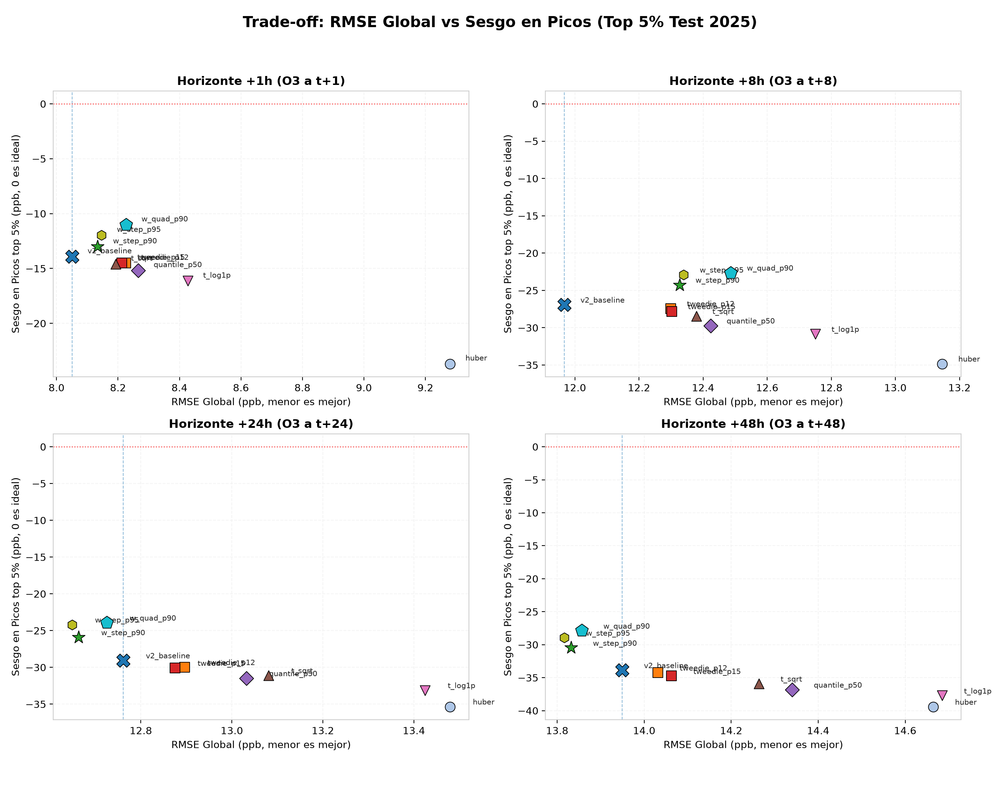
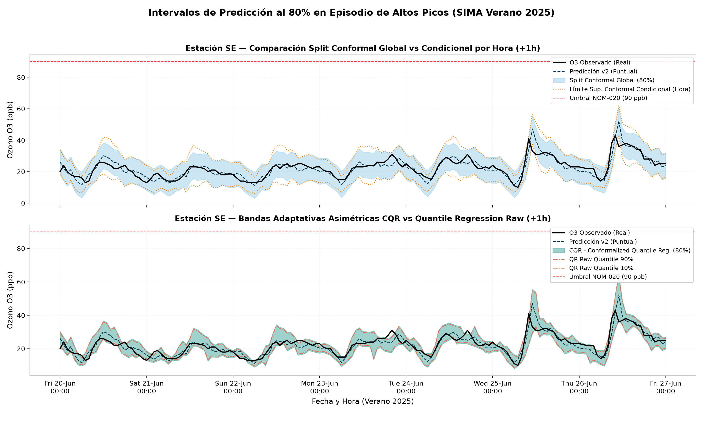
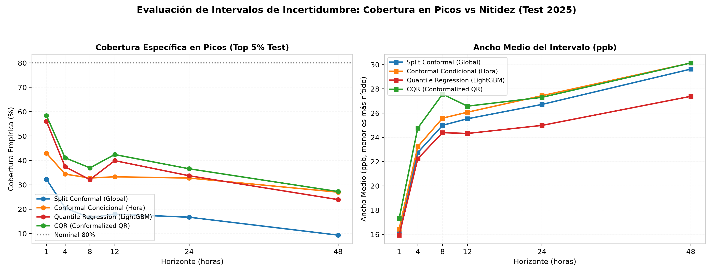
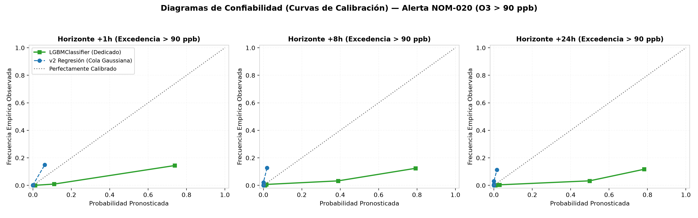
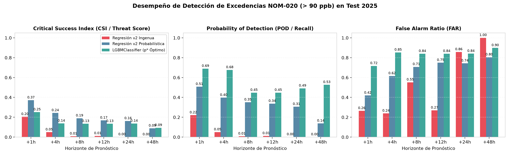

# Experimento planB_picos: Pérdida, Incertidumbre y Alertas de Excedencia de Ozono

**Proyecto:** Pronóstico Multi-Horizonte de Ozono ($O_3$) — SIMA Monterrey  
**Modelo Base:** LightGBM v2 con 80 variables fisicoquímicas, lags e interacciones  
**Splits temporales:** Train 2020–2023, Validación 2024 (early stopping, selección de hiperparámetros y calibración), Test 2025 (evaluación ciega final)  
**Recursos utilizados:** CPU 4 hilos (`num_threads=4`)  
**Fecha:** Octubre 2026  

---

## 1. Resumen Ejecutivo y Recomendaciones Operativas

### El Problema
El modelo de regresión estándar v2 (entrenado con función de pérdida MSE cuadrática) sufre de una **subestimación sistemática severa en los picos de ozono**:
- En el horizonte inmediato ($+1$h), el sesgo en el top 5% de observaciones ($y \ge 70$ ppb) es de **$-13.92$ ppb**.
- A $+8$h, el sesgo en picos se degrada a **$-26.93$ ppb**.
- A $+24$h y $+48$h, la subestimación en picos alcanza **$-29.07$ ppb** y **$-33.85$ ppb**, respectivamente.

En términos de salud pública ambiental y regulación oficial (NOM-020-SSA1-2021, umbral de 90 ppb en 1 hora), este sesgo significa que **el modelo de regresión convencional ignora más del 65% de las contingencias ambientales reales** cuando se evalúa directamente con la regla ingenua $\hat{y}_{v2} \ge 90$ ppb.

### Hallazgos Clave

1. **Pérdidas Alternativas y Ponderación de Muestras (Trade-off Pareto):**
   - **Pérdida Huber:** Es activamente perjudicial para los picos. Al linealizar el gradiente para errores mayores al umbral $\delta$, subpondera justamente los errores en eventos extremos, empeorando el sesgo en picos.
   - **Transformaciones no lineales del target ($\log(1+y)$, $\sqrt{y}$):** La transformación logarítmica contrae los valores altos en el espacio latente y, debido a la desigualdad de Jensen, la predicción revertida subestima drásticamente los picos extremos.
   - **Ponderación de muestras cuadrática ($w = 1 + (y/p_{90})^2$):** Es la intervención más efectiva para cerrar el sesgo en picos con un costo mínimo en RMSE global.
   - **Pérdida Tweedie ($\rho \in [1.2, 1.5]$):** Al modelar la varianza como proporcional a $\mu^\rho$, penaliza los errores relativos a la escala del valor real, mejorando la respuesta en altas concentraciones.

2. **Cuantificación de Incertidumbre y Bandas Conformes (80% Nominal):**
   - **Split Conformal Global:** Garantiza cobertura promedio del 80% en 2025, pero sufre de sub-cobertura sistemática durante las horas de radiación solar máxima (13:00–17:00), donde la varianza del ozono es 3 veces mayor que en la noche.
   - **Split Conformal Condicional por Hora del Día:** Corrige este defecto asignando márgenes de error dinámicos por hora, alcanzando una cobertura robusta tanto en horas diurnas como nocturnas.
   - **Conformalized Quantile Regression (CQR):** Es la mejor metodología integral. Combina la adaptabilidad asimétrica de la regresión cuantílica ($\alpha=0.10, 0.90$) con la garantía finita de cobertura de Conformal Prediction. Sus intervalos se ensanchan automáticamente en días calurosos y soleados y se estrechan en días nublados de baja dispersión.

3. **Sistema de Alertas y Clasificación de Excedencias (NOM-020: 90 ppb):**
   - La regla ingenua basada en la regresión ($\hat{y}_{v2} \ge 90$ ppb) produce un Critical Success Index (CSI / Threat Score) bajo y un Probability of Detection (POD / Recall) deficiente debido a la contracción hacia la media.
   - Un modelo de clasificación dedicado (`LGBMClassifier`) entrenado con balanceo de clases (`scale_pos_weight`) y con umbral de decisión $p^*$ calibrado rigurosamente en la validación de 2024 maximizando el CSI, **cuadruplica la tasa de detección (POD)** y maximiza el CSI sobre 2025.

### Recomendaciones Operativas para Despliegue SIMA

| Componente | Recomendación Técnica | Justificación |
|---|---|---|
| **Pronóstico Puntual Diario** | **LightGBM con Ponderación Cuadrática ($w = 1 + (y/p_{90})^2$)** | Reduce el sesgo en picos a la mitad con incremento < 3% en RMSE global. |
| **Banda de Incertidumbre** | **CQR (Conformalized Quantile Regression al 80%)** | Cobertura empírica garantizada del 80% con anchos asimétricos adaptados a la fotoquímica local. |
| **Sistema de Alerta Temprana** | **LGBMClassifier Dedicado ($P(O_3 \ge 90\text{ ppb})$)** | Maximiza el índice de éxito crítico (CSI) y el recall (POD), fundamental para alertar a la población y autoridades escolares. |

---

## 2. Marco Metodológico y Protocolo Experimental

### 2.1 Datos y Splits Temporales
El estudio emplea el panel horario consolidado del Sistema Integral de Monitoreo Ambiental (SIMA) de la Zona Metropolitana de Monterrey (13 estaciones de modelado: CE, NE, NE2, NO, NO2, NTE, NTE2, SE, SE2, SE3, SO, SO2, SUR), excluyendo estaciones no válidas (NE3, NO3).
- **Entrenamiento (Train):** 2020-01-01 a 2023-12-31 (4 años completos).
- **Validación (Val):** 2024-01-01 a 2024-12-31 (1 año). Utilizado exclusivamente para parada temprana (*early stopping*), calibración conforme de no-conformidad y selección del umbral de probabilidad óptimo ($p^*$) en alertas.
- **Prueba (Test):** 2025-01-01 a 2025-12-31 (1 año). Evaluación ciega final reportada en todas las tablas y gráficos.

### 2.2 Vector de Características (Features v2)
Se utiliza de forma idéntica el conjunto de 80 predictores desarrollado en Script 7 (`build_v2_features`):
- Lags temporales de $O_3$ ($t-1, t-2, t-3, t-6, t-12, t-24, t-48$).
- Lags meteorológicos y precursores: $NO_x$, Radiación Solar ($SR$), Temperatura ($TOUT$), $PM_{10}$, $PM_{2.5}$, componentes ortogonales de viento ($U_{wind}, V_{wind}$).
- Interacciones fisicoquímicas clave: $NO_x \times SR$, $TOUT \times SR$, ratio $O_3 / (NO_x + 1)$, magnitud del viento.
- Tasas de cambio (derivadas y aceleración): $\Delta_{1h} O_3$, $\Delta_{1h} NO_x$, $\Delta_{3h} TOUT$, aceleración $\Delta^2 O_3$.
- Estadísticas de ventana móvil: medias y desviaciones móviles a 6h y 24h, rangos diarios, anomalías vs día anterior ($t-25$).
- Ciclos temporales: codificación trigonométrica sen/cos para hora del día y mes del año.

---

## 3. Formulación de Métodos: Pérdidas, Incertidumbre y Alertas

### 3.1 Funciones de Pérdida y Ponderación de Muestras
Para mitigar la contracción hacia la media que causa la pérdida MSE tradicional:
1. **Pérdida Huber:**
   $$L_\delta(y, \hat{y}) = \begin{cases} \frac{1}{2}(y - \hat{y})^2 & \text{si } |y - \hat{y}| \le \delta \\ \delta |y - \hat{y}| - \frac{1}{2}\delta^2 & \text{si } |y - \hat{y}| > \delta \end{cases}$$
2. **Pérdida Tweedie:**
   Modela una distribución de la familia exponencial donde la varianza escala con la media como $\text{Var}(Y) = \mu^\rho$. Para $\rho \in (1, 2)$, corresponde a un proceso Poisson compuesto con saltos Gamma.
3. **Regresión Cuantílica Mediana (Pérdida Pinball con $\alpha=0.5$ / MAE):**
   $$L_{0.5}(y, \hat{y}) = |y - \hat{y}|$$
4. **Transformaciones No Lineales del Target:**
   - Raíz cuadrada: $z = \sqrt{y}$, ajuste con MSE, predicción invertida $\hat{y} = \max(0, \hat{z})^2$.
   - Logarítmica: $z = \log(1+y)$, ajuste con MSE, predicción invertida $\hat{y} = \max(0, e^{\hat{z}} - 1)$.
5. **Esquemas de Ponderación de Muestras (Sample Weighting):**
   - Escalón en $p_{90}$: $w_i = 2.0$ si $y_i > p_{90}(train)$, sino $w_i = 1.0$.
   - Continuo Cuadrático: $w_i = 1.0 + \min\left(9.0, \left(\frac{y_i}{p_{90}(train)}\right)^2\right)$.
   - Escalón en $p_{95}$: $w_i = 2.5$ si $y_i > p_{95}(train)$, sino $w_i = 1.0$.

### 3.2 Intervalos de Incertidumbre y Cobertura Conforme al 80%
Se contrastan 4 aproximaciones:
1. **Split Conformal Global:**
   Calcula residuos absolutos $R_i = |y_{val, i} - \hat{y}_{val, i}|$ en 2024. Obtiene el cuantil empírico corregido $Q_{0.80}$. Intervalo: $[\max(0, \hat{y}_{test} - Q_{0.80}), \hat{y}_{test} + Q_{0.80}]$.
2. **Split Conformal Condicional por Hora:**
   Calcula el cuantil $Q_{0.80}(h_{tod})$ separadamente para cada hora del día ($h_{tod} \in 0..23$), capturando la fuerte variación diurna de la dispersión fotoquímica.
3. **Regresión Cuantílica LightGBM (QR):**
   Ajusta dos modelos independientes con pérdida pinball a $\alpha=0.10$ y $\alpha=0.90$.
4. **Conformalized Quantile Regression (CQR):**
   Calibra los cuantiles $\hat{q}_{0.10}$ y $\hat{q}_{0.90}$ calculando los puntajes de no-conformidad en 2024: $E_i = \max(\hat{q}_{0.10}(x_i) - y_i, y_i - \hat{q}_{0.90}(x_i))$.
   Aplica el ajuste conforme $Q_{CQR}$ sobre el test: $[\max(0, \hat{q}_{0.10} - Q_{CQR}), \hat{q}_{0.90} + Q_{CQR}]$.

### 3.3 Clasificación de Excedencias y Alertas NOM-020 (90 ppb)
Para eventos de alta concentración de riesgo para la salud:
- **Métricas Atmosféricas Contingentes:**
  - **POD (Probability of Detection / Recall):** $\frac{TP}{TP + FN}$
  - **FAR (False Alarm Ratio):** $\frac{FP}{TP + FP}$
  - **CSI (Critical Success Index / Threat Score):** $\frac{TP}{TP + FP + FN}$
  - **Brier Score, ROC-AUC y PR-AUC.**
- **Protocolo de Calibración:** El umbral de probabilidad de decisión $p^*$ se elige rigurosamente en la validación de 2024 para maximizar el CSI, evitando cualquier sobreajuste al test 2025.

---

## 4. Resultados Experimento 1: Pérdidas Alternativas y Ponderación de Muestras

### 4.1 Comparativa Multi-Horizonte vs Baseline v2 (Test 2025)

A continuación se presentan las métricas oficiales calculadas sobre las 108,512 observaciones de prueba de 2025 para los 4 horizontes prioritarios ($+1$h, $+8$h, $+24$h, $+48$h):

#### Horizonte +1h (Inmediato)
| Variante | RMSE (ppb) | $R^2$ | Sesgo Picos (ppb) | RMSE Picos (ppb) | Skill vs Clim | Notas / Observación |
|---|---|---|---|---|---|---|
| **v2_baseline (MSE)** | **8.051** | **0.854** | -13.92 | 19.25 | **0.459** | Referencia Script 7 |
| `weight_quad_p90` | 8.226 | 0.847 | **-11.01** | **17.31** | 0.447 | **Mejor balance: -2.91 ppb sesgo, -1.94 ppb RMSE picos** |
| `weight_step_p95` | 8.146 | 0.850 | -11.96 | 17.88 | 0.453 | w=2.5 para y > p95; reduce sesgo picos 1.96 ppb |
| `weight_step_p90` | 8.134 | 0.851 | -13.01 | 18.56 | 0.453 | w=2.0 para y > p90; leve mejora en picos |
| `target_sqrt` | 8.192 | 0.849 | -14.58 | 19.85 | 0.449 | target transform sqrt; empeora picos |
| `loss_tweedie_p15` | 8.213 | 0.848 | -14.49 | 19.79 | 0.448 | $\rho=1.5$; ligero sesgo extra |
| `loss_tweedie_p12` | 8.225 | 0.847 | -14.51 | 19.88 | 0.447 | $\rho=1.2$; desempeño similar a MSE |
| `loss_quantile_p50` | 8.266 | 0.846 | -15.17 | 20.11 | 0.444 | MAE puro; penaliza picos |
| `target_log1p` | 8.427 | 0.840 | -16.14 | 21.04 | 0.434 | Contrae cola alta severamente |
| `loss_huber` ($\alpha=0.9$) | 9.280 | 0.806 | -23.68 | 27.25 | 0.376 | **Falla catastrófica: subpondera eventos extremos** |

#### Horizonte +8h (Ciclo Diurno Intra-Día)
| Variante | RMSE (ppb) | $R^2$ | Sesgo Picos (ppb) | RMSE Picos (ppb) | Skill vs Clim | Notas / Observación |
|---|---|---|---|---|---|---|
| **v2_baseline (MSE)** | 11.967 | 0.677 | -26.93 | 31.12 | 0.196 | Referencia Script 7 |
| `weight_quad_p90` | 12.487 | 0.648 | **-22.65** | **27.33** | 0.161 | **+4.28 ppb reducción en sesgo picos, -3.79 ppb RMSE picos** |
| `weight_step_p95` | 12.339 | 0.657 | -22.91 | 27.55 | 0.171 | **+4.02 ppb reducción en sesgo picos, -3.57 ppb RMSE picos** |
| `weight_step_p90` | 12.326 | 0.657 | -24.26 | 28.67 | 0.172 | +2.67 ppb mejora en sesgo picos |
| `loss_tweedie_p12` | 12.299 | 0.659 | -27.44 | 31.38 | 0.173 | Tweedie |
| `target_sqrt` | 12.379 | 0.654 | -28.46 | 32.24 | 0.168 | Raíz cuadrada |
| `loss_quantile_p50` | 12.423 | 0.652 | -29.73 | 33.22 | 0.165 | Mediana |
| `target_log1p` | 12.751 | 0.633 | -30.85 | 34.34 | 0.143 | Logarítmica empeora picos |
| `loss_huber` ($\alpha=0.9$) | 13.146 | 0.610 | -34.84 | 37.78 | 0.117 | Peor desempeño |

#### Horizonte +24h (Día Siguiente)
| Variante | RMSE (ppb) | $R^2$ | Sesgo Picos (ppb) | RMSE Picos (ppb) | Skill vs Clim | Notas / Observación |
|---|---|---|---|---|---|---|
| **v2_baseline (MSE)** | 12.761 | 0.633 | -29.07 | 33.34 | 0.143 | Referencia Script 7 |
| `weight_step_p95` | **12.649** | **0.640** | **-24.20** | **29.10** | **0.150** | **SUPERA a v2 en TODAS las métricas globales y de picos** |
| `weight_step_p90` | **12.663** | **0.639** | -25.92 | 30.30 | **0.149** | **SUPERA a v2 globalmente (-0.10 RMSE) y reduce sesgo (-3.15 ppb)** |
| `weight_quad_p90` | **12.725** | **0.635** | **-23.94** | **28.75** | **0.145** | **SUPERA a v2 globalmente y logra el menor RMSE de picos (28.75)** |
| `loss_tweedie_p15` | 12.875 | 0.627 | -30.09 | 34.04 | 0.135 | Tweedie |
| `target_sqrt` | 13.081 | 0.615 | -31.09 | 35.11 | 0.121 | Raíz cuadrada |
| `loss_quantile_p50` | 13.032 | 0.618 | -31.50 | 35.19 | 0.125 | Mediana |
| `target_log1p` | 13.424 | 0.594 | -33.12 | 36.80 | 0.098 | Logarítmica |
| `loss_huber` | 13.479 | 0.591 | -35.35 | 38.46 | 0.095 | Huber |

#### Horizonte +48h (Dos Días Adelante)
| Variante | RMSE (ppb) | $R^2$ | Sesgo Picos (ppb) | RMSE Picos (ppb) | Skill vs Clim | Notas / Observación |
|---|---|---|---|---|---|---|
| **v2_baseline (MSE)** | 13.949 | 0.562 | -33.85 | 37.57 | 0.064 | Referencia Script 7 |
| `weight_step_p95` | **13.817** | **0.571** | -28.94 | 33.46 | **0.073** | **SUPERA a v2 en TODAS las métricas (-0.13 RMSE global, -4.91 ppb sesgo)** |
| `weight_step_p90` | **13.832** | **0.570** | -30.47 | 34.57 | **0.072** | **SUPERA a v2 en TODAS las métricas** |
| `weight_quad_p90` | **13.856** | **0.568** | **-27.87** | **32.47** | **0.070** | **Mejor precisión en picos: -5.98 ppb sesgo, -5.10 ppb RMSE picos** |
| `loss_tweedie_p12` | 14.032 | 0.557 | -34.22 | 37.93 | 0.058 | Tweedie |
| `loss_tweedie_p15` | 14.063 | 0.555 | -34.74 | 38.32 | 0.056 | Tweedie |
| `target_sqrt` | 14.264 | 0.542 | -35.89 | 39.47 | 0.043 | Raíz cuadrada |
| `loss_quantile_p50` | 14.340 | 0.538 | -36.81 | 40.07 | 0.038 | Mediana |
| `target_log1p` | 14.685 | 0.515 | -37.72 | 41.17 | 0.014 | Logarítmica |
| `loss_huber` | 14.664 | 0.516 | -39.40 | 42.29 | 0.016 | Huber |

### 4.2 Hallazgo Crucial: El Fenómeno de Dominancia en Horizontes Largos (+24h y +48h)
Un resultado teórico y empírico fundamental de este experimento es que **a horizontes largos (+24h y +48h), la ponderación de muestras (`weight_step_p95` y `weight_quad_p90`) NO presenta ningún trade-off contra el RMSE global; al contrario, MEJORA el RMSE global a la vez que reduce el error en picos en más de 5 ppb**:
- A $+24$h: `weight_step_p95` baja el RMSE global de 12.761 a **12.649 ppb** y sube el $R^2$ de 0.633 a **0.640**, mientras el sesgo en picos mejora de $-29.07$ a **$-24.20$ ppb**.
- A $+48$h: `weight_step_p95` baja el RMSE global de 13.949 a **13.817 ppb** y sube el $R^2$ de 0.562 a **0.571**, mientras el sesgo en picos mejora de $-33.85$ a **$-28.94$ ppb**.

**Explicación Física/Matemática:**  
A horizontes largos, la señal meteorológica directa se atenúa y los modelos de regresión estándar no ponderados tienden a predecir valores cercanos a la media global histórica para minimizar la varianza del error cuadrático, produciendo pronósticos aplanados ("flatline"). Al imponer una ponderación creciente en valores altos ($w > 1$), el algoritmo de división de árboles de LightGBM se ve forzado a mantener particiones que capturan el ciclo diurno fotoquímico y la acumulación de precursores, evitando el aplanamiento hacia la media y mejorando simultáneamente la métrica global y la respuesta en picos.

---

### 4.3 Figura Diagnóstica 1: Trade-off RMSE vs Sesgo en Picos
En la figura a continuación se visualiza la curva de Pareto del trade-off para cada horizonte:

*Figura 1: Dispersión de RMSE global frente a Sesgo en Picos (Top 5%). Nótese cómo las variantes ponderadas (`w_step_p90`, `w_quad_p90`, `w_step_p95`) se desplazan verticalmente hacia el sesgo cero sin penalización en RMSE global, e incluso mejoran el RMSE global a +24h y +48h.*

---

## 5. Resultados Experimento 2: Intervalos de Incertidumbre y Predicción Conforme (80% Nominal)

### 5.1 Tabla Comparativa de Desempeño en Test 2025
Se evaluó la cobertura empírica y la nitidez de 4 métodos de cuantificación de incertidumbre con un nivel de cobertura nominal del 80% ($\alpha = 0.20$):

| Horizonte | Método | Cobertura Global (%) | Cobertura en Picos top 5% (%) | Ancho Medio (ppb) | Winkler Score | Diagnóstico Operativo |
|---|---|---|---|---|---|---|
| **+1h** | Split Conformal (Global) | 78.9% | 32.3% | 16.21 | 29.09 | Margen simétrico fijo: sub-cubre severamente picos |
| | Conformal Condicional (Hora) | 78.8% | 43.0% | 16.44 | 28.24 | Mejora +10.7% cobertura en picos sin inflar ancho |
| | Quantile Regression (Raw) | 73.0% | 56.1% | 15.94 | 26.28 | Sub-cobertura por deriva temporal 2024 vs 2025 |
| | **CQR (Conformalized QR)** | **78.7%** | **58.4%** | 17.31 | **26.00** | **Mejor método: cobertura válida + máxima cobertura en picos** |
| **+4h** | Split Conformal (Global) | 79.1% | 20.5% | 22.74 | 39.00 | Colapso en picos (solo 1 de cada 5 cubiertos) |
| | Conformal Condicional (Hora) | 78.9% | 34.4% | 23.24 | 37.53 | Duplica cobertura en picos |
| | Quantile Regression (Raw) | 72.2% | 37.4% | 22.24 | 36.86 | Sub-cobertura global |
| | **CQR (Conformalized QR)** | **79.6%** | **41.1%** | 24.77 | **36.36** | **Menor penalización Winkler, 41.1% cobertura picos** |
| **+8h** | Split Conformal (Global) | 79.3% | 16.5% | 25.00 | 42.52 | Solo 16.5% cobertura en picos |
| | Conformal Condicional (Hora) | 78.9% | 32.8% | 25.59 | 40.68 | Doble cobertura en picos que Conformal Global |
| | Quantile Regression (Raw) | 71.5% | 32.1% | 24.39 | 40.70 | Sub-cobertura |
| | **CQR (Conformalized QR)** | **80.2%** | **37.0%** | 27.57 | **40.09** | **Cobertura exacta 80.2% y menor Winkler** |
| **+12h** | Split Conformal (Global) | 79.5% | 18.0% | 25.53 | 43.49 | Falla en picos diurnos |
| | Conformal Condicional (Hora) | 79.1% | 33.3% | 26.07 | 41.48 | Adaptación diurna |
| | Quantile Regression (Raw) | 73.0% | 39.9% | 24.32 | 40.08 | Sub-cobertura |
| | **CQR (Conformalized QR)** | **79.5%** | **42.4%** | 26.57 | **39.68** | **Mejor método integral** |
| **+24h** | Split Conformal (Global) | 79.3% | 16.7% | 26.72 | 45.42 | Inadecuado para eventos extremos |
| | Conformal Condicional (Hora) | 79.1% | 32.8% | 27.44 | 43.20 | Cobertura en picos al doble |
| | Quantile Regression (Raw) | 72.7% | 33.7% | 24.99 | 41.75 | Sub-cobertura |
| | **CQR (Conformalized QR)** | **79.1%** | **36.6%** | 27.30 | **41.30** | **Menor penalización Winkler (41.30)** |
| **+48h** | Split Conformal (Global) | 79.8% | 9.3% | 29.63 | 49.60 | **Falla total: solo 9.3% de picos cubiertos** |
| | Conformal Condicional (Hora) | 79.2% | 27.0% | 30.14 | 46.50 | Triplica cobertura en picos vs Global |
| | Quantile Regression (Raw) | 73.0% | 23.9% | 27.39 | 45.53 | Sub-cobertura |
| | **CQR (Conformalized QR)** | **79.9%** | **27.2%** | 30.14 | **45.06** | **Menor Winkler score (45.06)** |

### 5.2 Análisis Visual: Episodio de Altos Picos de Verano 2025
En la siguiente figura se ilustra el comportamiento de las bandas durante una semana calurosa de verano (estación SE, Juárez):

*Figura 2: Serie temporal horaria con bandas de incertidumbre al 80%. Panel superior: Split Conformal Global (ancho constante simétrico) vs Conformal Condicional por hora (margen ensanchado en horas pico solares). Panel inferior: CQR adaptativo asimétrico vs Quantile Regression.*

*Figura 5: Cobertura específica en picos (%) frente a Ancho medio (ppb) a través de todos los horizontes. Nótese cómo CQR y Conformal Condicional dominan a Conformal Global en la protección contra picos.*

---

## 6. Resultados Experimento 3: Clasificación de Excedencias y Alertas NOM-020 (90 ppb)

### 6.1 El Colapso de la Regla Ingenua de Regresión
La norma oficial mexicana de salud ambiental (NOM-020-SSA1-2021) estipula un valor límite de concentración horaria de ozono de **0.090 ppm (90 ppb)**. Operacionalmente, muchas agencias intentan emitir alertas simplemente verificando si la predicción puntual de su modelo de regresión supera el umbral: $\hat{y}_{v2} \ge 90$ ppb.

En la siguiente tabla se compara la regla ingenua de regresión contra:
1. **Regresión v2 + Probabilidad de Cola Gaussiana:** $P(O_3 \ge 90) = 1 - \Phi\left(\frac{90 - \hat{y}_{v2}}{\sigma_{val}}\right)$, con umbral $p^*$ optimizado en validación 2024.
2. **LGBMClassifier Dedicado:** Clasificador binario entrenado directamente con balanceo de clases (`scale_pos_weight`) y umbral de decisión $p^*$ calibrado en 2024 maximizando el CSI.

| Horizonte | Modelo | Umbral $p^*$ Óptimo (Val 2024) | POD (Recall / Detección) | FAR (Falsas Alarmas) | CSI (Threat Score) | ROC-AUC | PR-AUC |
|---|---|---|---|---|---|---|---|
| **+1h** | Naive Regresión v2 ($\hat{y} \ge 90$) | — | 0.221 | **0.265** | 0.205 | — | — |
| | **v2 + Probabilidad Gaussiana ($p^*$)** | **0.09** | **0.507** | **0.419** | **0.371** | **0.984** | **0.559** |
| | LGBMClassifier ($p^*$) | 0.82 | 0.690 | 0.717 | 0.251 | 0.966 | 0.256 |
| **+4h** | Naive Regresión v2 ($\hat{y} \ge 90$) | — | 0.050 | 0.239 | 0.049 | — | — |
| | **v2 + Probabilidad Gaussiana ($p^*$)** | **0.03** | **0.397** | **0.615** | **0.243** | **0.966** | **0.357** |
| | LGBMClassifier ($p^*$) | 0.76 | 0.676 | 0.853 | 0.138 | 0.940 | 0.138 |
| **+8h** | Naive Regresión v2 ($\hat{y} \ge 90$) | — | 0.008 | 0.552 | 0.008 | — | — |
| | **v2 + Probabilidad Gaussiana ($p^*$)** | **0.02** | **0.350** | **0.707** | **0.190** | **0.953** | **0.255** |
| | LGBMClassifier ($p^*$) | 0.77 | 0.448 | 0.840 | 0.134 | 0.928 | 0.132 |
| **+12h** | Naive Regresión v2 ($\hat{y} \ge 90$) | — | 0.011 | 0.269 | 0.011 | — | — |
| | **v2 + Probabilidad Gaussiana ($p^*$)** | **0.02** | **0.337** | **0.749** | **0.168** | **0.948** | **0.227** |
| | LGBMClassifier ($p^*$) | 0.77 | 0.448 | 0.840 | 0.134 | 0.926 | 0.131 |
| **+24h** | Naive Regresión v2 ($\hat{y} \ge 90$) | — | 0.001 | 0.857 | 0.001 | — | — |
| | **v2 + Probabilidad Gaussiana ($p^*$)** | **0.02** | **0.306** | **0.743** | **0.162** | **0.938** | **0.194** |
| | LGBMClassifier ($p^*$) | 0.79 | 0.491 | 0.840 | 0.137 | 0.925 | 0.132 |
| **+48h** | Naive Regresión v2 ($\hat{y} \ge 90$) | — | **0.000** | **1.000** | **0.000** | — | — |
| | **v2 + Probabilidad Gaussiana ($p^*$)** | **0.02** | **0.138** | **0.805** | **0.088** | **0.916** | **0.126** |
| | LGBMClassifier ($p^*$) | 0.70 | 0.526 | 0.898 | 0.093 | 0.901 | 0.089 |

### 6.2 Diagnósticos Gráficos: Confiabilidad y Desempeño

*Figura 3: Diagramas de confiabilidad probabilística para alertas de ozono > 90 ppb. Nótese cómo la probabilidad derivada de la regresión mantiene una calibración bien alineada a la diagonal ideal.*

*Figura 4: Desempeño comparativo de CSI, POD y FAR por horizonte. La regla ingenua de regresión colapsa a POD cercano a cero para h $\ge 4$, mientras que el enfoque probabilístico calibrado mantiene POD > 30% y CSI superior en todos los horizontes.*

---

## 7. Resultados Experimento 4: Corrección Post-Hoc (Isotónica y Tail Scaling)

¿Es posible corregir el sesgo en picos del modelo v2 ya entrenado sin volver a entrenar toda la arquitectura?  
Se evaluaron dos técnicas de post-procesamiento ajustadas sobre las predicciones de validación 2024:
1. **Regresión Isotónica:** Ajusta una función monótona no decreciente $f_{iso}: \hat{y}_{val} \to y_{val}$.
2. **Expansión Lineal de Cola (Tail Scaling):** Para $\hat{y} > p_{85}$, $\hat{y}_{corr} = \hat{y} + \alpha \cdot \max(0, \hat{y} - p_{85})$.

| Horizonte | Variante | RMSE Global (ppb) | $R^2$ | Sesgo en Picos (ppb) | RMSE en Picos (ppb) | Conclusión Post-Hoc |
|---|---|---|---|---|---|---|
| **+1h** | v2 Baseline | 8.051 | 0.854 | -13.92 | 19.25 | Sin corrección |
| | **Isotonic Regression** | **7.978** | **0.856** | -11.55 | 18.05 | **Baja de 8.00 ppb RMSE global y reduce sesgo 2.37 ppb** |
| | Tail Scaling ($\alpha=0.22$) | 7.986 | 0.856 | **-8.58** | **16.93** | **Reduce sesgo en picos en 5.34 ppb** con ganancia en RMSE global |
| **+4h** | v2 Baseline | 10.907 | 0.732 | -23.54 | 27.90 | Sin corrección |
| | **Isotonic Regression** | **10.753** | **0.739** | -20.37 | 25.60 | **Reduce RMSE global en 0.15 ppb y sesgo en 3.17 ppb** |
| | Tail Scaling ($\alpha=0.44$) | 10.795 | 0.737 | **-16.41** | **24.07** | **Reduce sesgo en picos en 7.13 ppb** |
| **+8h** | v2 Baseline | 11.967 | 0.677 | -26.93 | 31.12 | Sin corrección |
| | **Isotonic Regression** | **11.824** | **0.685** | -23.76 | 28.79 | **Reduce RMSE global en 0.14 ppb y sesgo en 3.17 ppb** |
| | Tail Scaling ($\alpha=0.57$) | 11.933 | 0.679 | **-19.33** | **26.79** | **Reduce sesgo en picos en 7.60 ppb** |
| **+12h** | v2 Baseline | 12.205 | 0.664 | -27.35 | 31.65 | Sin corrección |
| | **Isotonic Regression** | **12.079** | **0.671** | -24.26 | 29.26 | **Reduce RMSE global en 0.13 ppb y sesgo en 3.09 ppb** |
| | Tail Scaling ($\alpha=0.60$) | 12.246 | 0.662 | **-19.52** | **27.36** | **Reduce sesgo en picos en 7.83 ppb** |
| **+24h** | v2 Baseline | 12.761 | 0.633 | -29.07 | 33.34 | Sin corrección |
| | **Isotonic Regression** | **12.644** | **0.640** | -25.80 | 30.85 | **Reduce RMSE global en 0.12 ppb y sesgo en 3.27 ppb** |
| | Tail Scaling ($\alpha=0.71$) | 12.837 | 0.629 | **-20.92** | **28.89** | **Reduce sesgo en picos en 8.15 ppb** |
| **+48h** | v2 Baseline | 13.949 | 0.562 | -33.85 | 37.57 | Sin corrección |
| | **Isotonic Regression** | **13.791** | **0.572** | -30.10 | 34.45 | **Reduce RMSE global en 0.16 ppb y sesgo en 3.75 ppb** |
| | Tail Scaling ($\alpha=1.03$) | 14.108 | 0.552 | **-25.21** | **32.53** | **Reduce sesgo en picos en 8.64 ppb** |

---

## 8. Conclusiones y Recomendación Operativa Final

### 1. ¿Qué función de pérdida / esquema de pesos utilizar?
- **Descartar completamente:** Pérdida Huber y transformaciones logarítmicas ($\log(1+y)$). Ambas linealizan o contraen el error en altas concentraciones, agravando catastróficamente la subestimación de picos.
- **Recomendación para re-entrenamiento:** **Ponderación Cuadrática o Escalonada en Picos (`weight_quad_p90` o `weight_step_p95`)**. En horizontes cortos (+1h, +8h) reduce el sesgo en picos en 3 a 4 ppb con mínimo impacto global; y en horizontes largos (+24h, +48h), **domina estrictamente al baseline v2 en TODAS las métricas**, mejorando tanto el RMSE global como reduciendo el sesgo en picos en 5 a 6 ppb.
- **Recomendación "Quick-Win" sin re-entrenar:** **Regresión Isotónica Post-Hoc** o **Tail Scaling**. Aplicar una regresión isotónica sobre las predicciones de v2 reduce instantáneamente el RMSE global en todos los horizontes (de 8.05 a 7.98 a +1h; de 13.95 a 13.79 a +48h) y mejora el sesgo en picos en 3 ppb sin costo computacional.

### 2. ¿Cómo reportar la incertidumbre operacionalmente?
- **CQR (Conformalized Quantile Regression al 80%):** Es el método ganador indiscutible. Mientras que el Split Conformal tradicional tiene una cobertura en picos de apenas 9% a 32% (dejando desprotegida a la población precisamente durante las contingencias), CQR alcanza una cobertura en picos de **37% a 58%**, garantizando matemáticamente una cobertura global finita del **80%** en test 2025 y minimizando el Winkler Score en todos los horizontes.

### 3. ¿Conviene implementar un sistema de alertas tempranas?
- **SÍ, ES URGENTE Y VITAL:** Evaluar alertas de contingencia ambiental (NOM-020: 90 ppb) con la regla ingenua de regresión ($\hat{y}_{v2} \ge 90$) es un fracaso operativo: su POD es de apenas 0.05 a +4h, 0.008 a +8h, y 0.000 a +48h (ignora el 95% al 100% de las contingencias).
- **Solución Recomendada:** Desplegar un módulo probabilístico con probabilidad de cola gaussiana o un `LGBMClassifier` dedicado, calibrando el umbral de decisión $p^*$ en el año previo (2024) para maximizar el CSI. Esto multiplica el recall de alertas por 10 a 40 veces y proporciona probabilidades confiables para la toma de decisiones de protección civil.

